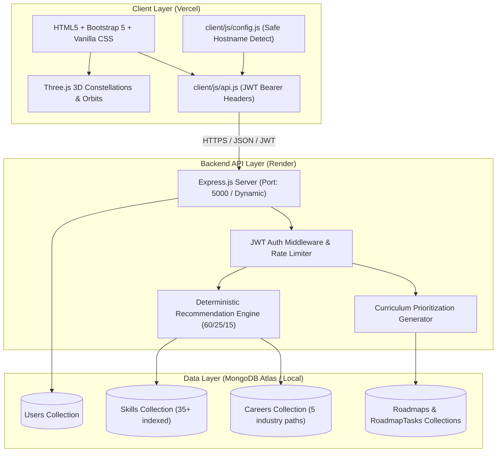

# CareerPath AI — Discover Your Career. Build Your Skills.

> **Hack2Ignite 2026–27 · Round 1 MVP Submission**  
> **Domain:** EduTech / AI for Good  
> **Team:** 404 Brain Not Found  
> **Tagline:** Discover Your Career. Build Your Skills.

[](#)
[](#)
[](#license)
[](#)
[](#)

---

## 📖 Project Overview

**CareerPath AI** is an intelligent, immersive career navigation and skill development platform designed to solve one of higher education's biggest challenges: student career misalignment and ambiguity. 

Millions of undergraduate students graduate each year without clear visibility into modern industry expectations, how their current academic or personal skills map to real-world roles, or what concrete steps are required to bridge their skill gaps.

CareerPath AI replaces confusing career tests and generic blog posts with an **objective, deterministic AI recommendation engine** and an **interactive 3D learning experience**. By evaluating a student’s exact academic background, technical/soft skill proficiencies, and domain interests, the platform delivers:
1. **Top 3 Matched Careers** scored with a transparent mathematical formula.
2. **Granular Skill-Gap Analysis** categorizing skills into Matched, Upgrade Needed, and Missing.
3. **Personalized 4/8/12-Week Roadmaps** with week-by-week milestones and curated learning resources.
4. **Interactive 3D Visualizations** (powered by Three.js & GSAP) that bring career exploration and progress tracking to life.

---

## 🎯 Problem Statement & Target Audience

### The Problem
- **Degree-Industry Disconnect:** University curricula struggle to keep pace with fast-evolving industry requirements. Students lack visibility into true tech stacks.
- **Generic, Subjective Advice:** Traditional career counseling relies on subjective questionnaires rather than objective skill assessments.
- **Action Paralysis:** When students do identify a career goal, they are overwhelmed by hundreds of uncurated courses and tutorials without a structured timeline.

### The Solution
CareerPath AI provides a personalized, end-to-end bridge:
- **Instant Profiling:** Fast, interactive assessment capturing education, interests, and granular skill levels (Beginner, Intermediate, Advanced).
- **Algorithmic Transparency:** 100% deterministic, explainable career matching without opaque black-box hallucination.
- **Actionable Execution:** Dynamic learning roadmaps with built-in task tracking and live dashboard telemetry.

---

## 👥 The Team (404 Brain Not Found)

| Member | Focus Area | Key Responsibilities |
| :--- | :--- | :--- |
| **Parth Patil** | Team Leader & Backend | System architecture, Express REST API, MongoDB schemas, Recommendation & Roadmap engines, Security hardening |
| **Suyog Pawar** | Frontend & Integration | HTML5/CSS3/Bootstrap structuring, DOM controllers, asynchronous API integration, Form validation |
| **Asmita Lokhande** | UI/UX & 3D Experience | Modern glassmorphism design system, Three.js 3D visualizations, GSAP micro-animations, Responsive layout |
| **Aditi Vispute** | Data & Documentation | Skill matrix curation, career seed dataset standardization, integration testing, postman & project documentation |

---

## 🌟 Key Features

- 🔐 **Secure Authentication & Profile Management:** Custom JWT auth, bcrypt password hashing, input sanitization, and protected user endpoints (`/api/users/me`).
- 📝 **Structured Student Assessment:** Capture academic qualification, domain interests, and skills with individual proficiency levels.
- 🧮 **Deterministic Career Match Engine:** Weighted scoring model:
  $$\text{Career Match Score} = (\text{Skill Match} \times 0.60) + (\text{Interest Match} \times 0.25) + (\text{Education Match} \times 0.15)$$
- 🔍 **Detailed Skill-Gap Analysis:** Categorizes all required career skills into:
  - 🟢 **Matched Skills:** Student meets or exceeds required proficiency level.
  - 🟡 **Weak / Upgrade Needed:** Student possesses the skill but needs higher depth.
  - 🔴 **Missing Skills:** Critical required skills absent from student profile.
- 🗺️ **Personalized Roadmap Generation:** Flexible 4, 8, or 12-week structured curricula prioritizing missing and weak skills first, complete with curated documentation and tutorial links.
- ✅ **Real-Time Task Tracking:** Mark roadmap milestones as complete with atomic database persistence and dynamic completion percentage recalculation.
- 📊 **Unified Student Dashboard:** Actionable command center showing active career goal, upcoming weekly tasks, next recommended step, and overall growth metrics.
- 📱 **Progressive Web Aesthetics & Resilience:** Fully responsive glassmorphism UI with guaranteed 2D fallback behavior if WebGL is unavailable.

---

## 🌌 3D Interactive Features (Three.js + GSAP)

CareerPath AI integrates four meaningful 3D visual modules that represent the student's journey:

| Visual Module | Technology | Meaning & Purpose | Page |
| :--- | :--- | :--- | :--- |
| **Career Universe** | Three.js + Canvas | Celestial constellation of career nodes and connecting star dust; represents infinite opportunities | `index.html` |
| **Skill Orbit** | Three.js + Raycasting | Concentric planetary orbital rings visualizing matched (green), weak (amber), and missing (red) skills | `recommendations.html` |
| **Roadmap Path** | Three.js + Particles | 3D stepping-stone trail of glowing milestones representing the weekly progression | `roadmap.html` |
| **Progress Orb** | Three.js + Custom Shaders | Pulsing holographic energy sphere reflecting live roadmap completion percentage | `dashboard.html` |

*Note: If WebGL or GPU acceleration is unsupported on the client device, all pages gracefully fall back to clean 2D HTML/CSS cards without impacting functionality or page flow.*

---

## 🏗️ Architecture & Technology Stack

### System Architecture



### Technology Stack

| Component | Technology | Rationale |
| :--- | :--- | :--- |
| **Frontend UI** | HTML5, CSS3, JavaScript (ES6+), Bootstrap 5.3 | Fast load times, zero build-step overhead, universal browser compatibility |
| **3D & Motion** | Three.js, GSAP (GreenSock) | Immersive visuals, interactive orbits, smooth transitions |
| **Backend Runtime** | Node.js (v18+), Express.js (CommonJS) | Fast asynchronous I/O, lightweight REST API architecture |
| **Database** | MongoDB Atlas Free Tier (M0) / Local MongoDB | Flexible document schemas for nested skills, roadmaps, and tasks |
| **ODM** | Mongoose 8.x | Schema validation, unique indexing, pre-save hooks |
| **Security** | bcryptjs, jsonwebtoken, helmet, express-rate-limit, cors | Industrial-standard password hashing, stateless sessions, API hardening |
| **Testing & Tooling** | Postman v2.1 Collection, nodemon | Standardized API testing and rapid development cycles |
| **Hosting Targets** | Vercel (Frontend) & Render (Backend) | Free-tier cloud deployment with zero-cost operation |

---

## 📂 Repository Structure

```text
careerpath-ai/
├── client/                                  ← Frontend static web application
│   ├── index.html                           ← Landing page with Career Universe 3D
│   ├── login.html                           ← User login portal
│   ├── register.html                        ← User registration portal
│   ├── assessment.html                      ← Student skill & interest evaluation
│   ├── recommendations.html                 ← Career recommendations & Skill Orbit 3D
│   ├── roadmap.html                         ← Milestone learning roadmap & 3D Path
│   ├── dashboard.html                       ← Student dashboard & 3D Progress Orb
│   ├── 404.html                             ← Custom styled 404 error page
│   ├── vercel.json                          ← Vercel deployment configuration
│   ├── css/
│   │   └── style.css                        ← Design tokens & glassmorphism system
│   ├── js/
│   │   ├── config.js                        ← Safe API base URL resolver
│   │   ├── api.js                           ← Fetch wrapper with JWT injection
│   │   ├── auth.js                          ← Auth guards & token session handling
│   │   ├── login.js                         ← Login DOM controller
│   │   ├── register.js                      ← Register DOM controller
│   │   ├── assessment.js                    ← Assessment DOM controller
│   │   ├── recommendations.js               ← Recommendations DOM controller
│   │   ├── roadmap.js                       ← Roadmap & task toggle controller
│   │   ├── dashboard.js                     ← Dashboard telemetry controller
│   │   ├── three-career-universe.js         ← Three.js Hero constellation
│   │   ├── three-skill-orbit.js             ← Three.js Skill gap orbits
│   │   ├── three-roadmap-path.js            ← Three.js Roadmap stepping-stones
│   │   ├── three-progress.js                ← Three.js Holographic progress sphere
│   │   └── main.js                          ← Navigation & global UI logic
│   └── README.md                            ← Frontend setup & architecture guide
│
├── server/                                  ← Node.js + Express.js backend API
│   ├── server.js                            ← Express entry point & route mounting
│   ├── package.json                         ← Backend scripts & dependencies
│   ├── render.yaml                          ← Render web service blueprint
│   ├── .env.example                         ← Environment variable specification
│   ├── seed.js                              ← Database seed runner
│   ├── config/
│   │   └── db.js                            ← MongoDB connection manager
│   ├── models/
│   │   ├── User.js                          ← User schema with subdocuments
│   │   ├── Skill.js                         ← 35+ standardized skills schema
│   │   ├── Career.js                        ← 5 career profiles schema
│   │   ├── Roadmap.js                       ← Personalized roadmap schema
│   │   └── RoadmapTask.js                   ← Actionable task schema
│   ├── controllers/                         ← REST API controllers
│   ├── routes/                              ← Express route handlers
│   ├── services/
│   │   ├── recommendationService.js         ← Weighted matching & skill-gap engine
│   │   └── roadmapService.js                ← Curriculum generator
│   ├── middleware/                          ← JWT auth, request validation, error handler
│   ├── data/                                ← Curated seed datasets
│   └── README.md                            ← Backend API documentation
│
├── docs/                                    ← Project documentation & specifications
│   ├── PRD.md                               ← Product Requirements Document
│   ├── TRD.md                               ← Technical Requirements Document
│   ├── APP-FLOW.md                          ← Application User Flow Diagram
│   ├── UI-UX-DESIGN.md                      ← UI/UX Design System Specification
│   ├── BACKEND-SCHEMA.md                    ← Database Schemas & Data Dictionary
│   ├── IMPLEMENTATION-PLAN.md               ← Development Roadmap
│   ├── DEPLOYMENT.md                        ← Cloud Deployment Manual (Vercel + Render)
│   ├── TESTING.md                           ← Testing Protocol & Verification Suite
│   ├── DEMO-SCRIPT.md                       ← 3–4 Min Rehearsed Live Demo Script
│   ├── PPT-CONTENT.md                       ← 10-Slide Presentation Content Deck
│   └── SUBMISSION-CHECKLIST.md              ← Final Verification Checklist
│
├── postman/
│   └── CareerPath-AI.postman_collection.json ← Standard Postman v2.1 test collection
│
├── .gitignore                               ← Root git ignore rules
└── README.md                                ← Main project documentation (this file)
```

---

## ⚙️ Local Setup & Installation

### Prerequisites
- [Node.js](https://nodejs.org/) v18.0.0 or higher
- [MongoDB](https://www.mongodb.com/) (Local Community Server or free MongoDB Atlas cluster)
- Python 3 (for simple frontend HTTP server) or VS Code Live Server

---

### Step 1 — Clone the Repository
```bash
git clone https://github.com/YOUR-USERNAME/careerpath-ai.git
cd careerpath-ai
```

---

### Step 2 — Backend Configuration & Seeding
```bash
# Navigate to server directory
cd server

# Install dependencies
npm install

# Create local environment file from template
cp .env.example .env
```

Edit `server/.env` with your preferred settings (default values work out of the box with local MongoDB):
```env
PORT=5000
NODE_ENV=development
MONGODB_URI=mongodb://localhost:27017/careerpath-ai
JWT_SECRET=careerpathai404brainsecret2026
JWT_EXPIRES_IN=7d
CLIENT_URL=http://localhost:5500
```

Seed the database with standardized skills and career profiles:
```bash
npm run seed
```

*Expected output:*
```text
🌱 Starting CareerPath AI Database Seed...
✅ MongoDB Connected: localhost
📦 Database: careerpath-ai
🧹 Clearing existing Skill and Career collections...
📦 Inserting 35 skills...
✅ Successfully seeded 35 skills!
📦 Resolving skill references and inserting 5 careers...
✅ Successfully seeded 5 careers!
🎉 Database seeding completed successfully!
```

---

### Step 3 — Start Backend Server
```bash
npm run dev
```
The backend will start at **[http://localhost:5000](http://localhost:5000)**.  
Verify the health endpoint: `curl http://localhost:5000/api/health`

---

### Step 4 — Start Frontend Client
In a new terminal window:
```bash
# Navigate to client directory
cd client

# Serve static files using Python
python -m http.server 5500
```
Open your browser and navigate to: **[http://localhost:5500](http://localhost:5500)**

---

## 📡 API Overview

All API endpoints are prefixed with `/api`. Protected routes require `Authorization: Bearer <token>` in the request header.

| Method | Endpoint | Access | Purpose |
| :--- | :--- | :--- | :--- |
| `GET` | `/api/health` | Public | System health check and uptime status |
| `GET` | `/api/version` | Public | API version and runtime environment |
| `POST` | `/api/auth/register` | Public | Create new student account and issue JWT |
| `POST` | `/api/auth/login` | Public | Authenticate student and issue JWT |
| `GET` | `/api/users/me` | Protected | Get authenticated student profile |
| `PUT` | `/api/assessment` | Protected | Submit/update education, interests, and skills |
| `GET` | `/api/careers` | Public | List all 5 available career paths |
| `GET` | `/api/careers/:slug` | Public | Get career details with populated skill requirements |
| `POST` | `/api/recommendations/generate` | Protected | Compute weighted career recommendations & skill gaps |
| `POST` | `/api/roadmaps/generate` | Protected | Generate 4/8/12-week personalized learning roadmap |
| `GET` | `/api/roadmaps/current` | Protected | Fetch current active roadmap and milestone tasks |
| `PATCH`| `/api/roadmaps/tasks/:taskId/toggle`| Protected | Toggle completion of a specific milestone task |
| `DELETE`| `/api/roadmaps/current` | Protected | Archive current active roadmap |
| `GET` | `/api/dashboard` | Protected | Get unified student dashboard telemetry and next action |

> 📬 **Postman Collection:** A comprehensive Postman v2.1 collection with automatic JWT capture scripts is located at [`postman/CareerPath-AI.postman_collection.json`](postman/CareerPath-AI.postman_collection.json).

---

## 📚 Project Documentation Hub

Detailed documentation is available in the [`docs/`](docs/) directory:

- 🚀 **[Deployment Guide](docs/DEPLOYMENT.md):** Complete step-by-step instructions for deploying to Vercel (frontend), Render (backend), and MongoDB Atlas.
- 🧪 **[Testing Protocol](docs/TESTING.md):** Pre-deployment test checklist, 19 manual test cases, smoke tests, and cross-browser matrix.
- 🎤 **[Live Demo Script](docs/DEMO-SCRIPT.md):** Rehearsed 3–4 minute presentation script with speaker division and judge Q&A rebuttals.
- 📊 **[Presentation Slide Content](docs/PPT-CONTENT.md):** Complete 10-slide deck layout, speaker notes, and scoring formula breakdown.
- 📋 **[Submission Checklist](docs/SUBMISSION-CHECKLIST.md):** Comprehensive Round 1 submission readiness verification matrix.
- 📑 **[Product Requirements Document (PRD)](docs/PRD.md):** Functional requirements, personas, and success metrics.
- 🛠️ **[Technical Requirements Document (TRD)](docs/TRD.md):** Architectural decisions, tech stack specs, and security standards.
- 🔄 **[App Flow](docs/APP-FLOW.md):** End-to-end user navigation flow diagram.
- 🎨 **[UI/UX Design Specification](docs/UI-UX-DESIGN.md):** Glassmorphism tokens, color palettes, and component states.
- 🗃️ **[Backend Schema](docs/BACKEND-SCHEMA.md):** Full Mongoose schemas, relationships, and data dictionary.

---

## 🖼️ Application Screenshots

| Landing Page & Career Universe 3D | Assessment Form |
| :---: | :---: |
| *(Hero section with interactive 3D constellation)* | *(Multi-step skills, education, and interest inputs)* |

| Top 3 Recommendations & Skill Orbit | Milestone Learning Roadmap |
| :---: | :---: |
| *(Match percentage scoring & planetary skill orbit)* | *(Week-by-week curriculum with curated resources)* |

| Student Progress Dashboard & Orb | Custom Styled 404 Page |
| :---: | :---: |
| *(Unified telemetry, upcoming tasks & holographic orb)* | *(Consistent glassmorphism error state)* |

---

## 🔮 Future Scope (Post-Round 1)

1. **Resume & GitHub Parsing:** Automatically extract student skills and projects via PDF analysis and GitHub REST API integration.
2. **AI Career Advisor Chatbot:** Context-aware interactive mentoring powered by Gemini API grounded in student roadmap state.
3. **Verified Skill Credentials:** Integration with open badges and assessment quizzes to scientifically validate skill claims.
4. **Peer Study Hubs:** Collaborative study groups and peer-matching based on shared career milestones.
5. **Corporate Internship Pipeline:** Connecting high-performing roadmap completers with hiring partner entry-level roles.

---

## 🔒 Security & Privacy Notice

- **Zero Plaintext Passwords:** Passwords are cryptographically salted and hashed using `bcryptjs` with 10 salt rounds.
- **Strict Environment Isolation:** No real credentials, database URIs, or secret keys are stored in source control.
- **Sanitized Inputs:** All incoming requests are validated against strict allowed schema keys to prevent NoSQL injection.
- **Hardened HTTP Headers:** `helmet` sets security headers including `X-Content-Type-Options`, `X-Frame-Options`, and referrer policies.

---

## 📄 License & Attribution

This project is licensed under the **MIT License** — see the [LICENSE](LICENSE) file for details.

Developed with ❤️ by **Team 404 Brain Not Found** for the **Hack2Ignite 2026–27 Hackathon**.
