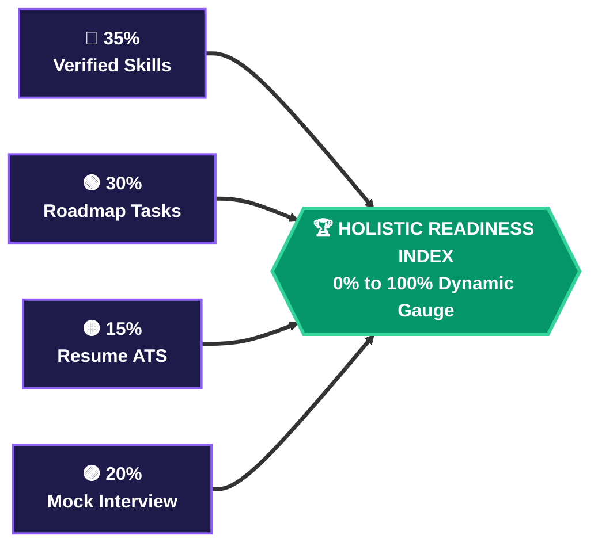
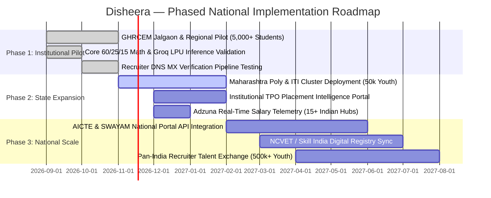

# 🇮🇳 SEVA FIRST INNOVATION CHALLENGE (SFIC 2026) — Official Charts & Submission Deck

> **Organizers:** Ministry of Education's Innovation Cell (MIC) & All India Council for Technical Education (AICTE), Government of India  
> **Theme:** *Educated, skilled, and secure Bharat* | Under the vision of **Viksit Bharat @ 2047**  
> **Team Name:** `404 Brain Not Found`  
> **Institution:** G.H. Raisoni College of Engineering and Management (GHRCEM), Jalgaon  
> **Project Title:** `Disheera — Two-Factor Skill Verified Career GPS & Recruiter Talent Radar Platform`  
> **Live Web Application:** [disheera.site](https://disheera.site)  
> **Production REST API:** [api.disheera.site](https://api.disheera.site)  

---

## 📌 1. THE PRIMARY METHODOLOGY & IMPLEMENTATION FLOWCHART
### (Slide 3 Official Deliverable: "Flow Charts / Images / working prototype")

*Official end-to-end dataflow showing how Indian youth (Tier-2/3 colleges, ITIs, polytechnics) are onboarded, verified with proof-of-work, diagnosed through transparent mathematics, and connected directly to verified employment:*

```mermaid
flowchart TD
    classDef intake fill:#1E1B4B,stroke:#8B5CF6,stroke-width:2px,color:#FFFFFF,font-weight:bold;
    classDef verify fill:#1E3A8A,stroke:#60A5FA,stroke-width:2px,color:#FFFFFF,font-weight:bold;
    classDef math fill:#B45309,stroke:#F59E0B,stroke-width:2px,color:#FFFFFF,font-weight:bold;
    classDef diag fill:#0F766E,stroke:#14B8A6,stroke-width:2px,color:#FFFFFF,font-weight:bold;
    classDef action fill:#4C1D95,stroke:#A855F7,stroke-width:2px,color:#FFFFFF,font-weight:bold;
    classDef radar fill:#065F46,stroke:#10B981,stroke-width:2px,color:#FFFFFF,font-weight:bold;
    classDef seva fill:#15803D,stroke:#4ADE80,stroke-width:3px,color:#FFFFFF,font-weight:bold;

    subgraph ROW1 [PHASE I: DIAGNOSIS & VERIFICATION]
        S1[1. Mass Youth Intake<br/>ITIs, Poly, Tier-2/3 Colleges<br/>76+ NCVET/NSQF Skills]:::intake
        S2[2. Two-Factor Verification<br/>Strand A: GitHub AST Code<br/>Strand B: Groq LPU Quiz &lt;300ms]:::verify
        S3[3. 60/25/15 Math Engine<br/>Deterministic Scoring &lt;50ms<br/>Zero Black-Box Bias]:::math
        S4[4. Tri-Color Gap Matrix<br/>🟢 Ready · 🟡 Upgrade · 🔴 Missing<br/>Instant Objective Audit]:::diag
    end

    subgraph ROW2 [PHASE II: REMEDIATION & SEVA PLACEMENT]
        S5[5. Synergized Roadmaps<br/>Anti-Scrub Video Chamber<br/>1-Click Offline PDF Guides]:::action
        S6[6. AI Resume & Mock Viva<br/>Magic-Byte PDF ATS Parser<br/>Adaptive AI Technical Interview]:::verify
        S7[7. Recruiter Talent Radar<br/>Corporate Domain Auth (DNS MX)<br/>96% AI Match · 1-Click Apply]:::radar
        S8[8. Viksit Bharat Placement<br/>HMAC Cryptographic Credential<br/>Elevating ₹3.5L to ₹8L–₹14L CTC]:::seva
    end

    S1 ==>|Authenticated Sync| S2
    S2 ==>|Verified Skill Vector| S3
    S3 ==>|In-Memory Math| S4
    S4 ==>|Targeted Milestones| S5
    S5 ==>|Portfolio Ready| S6
    S6 ==>|Pre-Assessed Profile| S7
    S7 ==>|Direct Corporate Hire| S8
```

### 📋 Slide 3 Flowchart Box (Text / PPT Layout Format)
```
════════════════════════════════════════════════════════════════════════════════════════════════════════════
 [ 1. Student Profiling ] ──► [ 2. Two-Factor Verification ] ──► [ 3. 60/25/15 Match Engine ] ──► [ 4. Tri-Color Gap Matrix ]
 (ITIs/Poly/Tier-2/3 Intake)     (GitHub AST + Groq LPU Quiz)     (Deterministic Math <50ms)        (🟢 Ready 🟡 Upgr 🔴 Miss)
                                                                                                               │
                                                                                               Actionable Route│
                                                                                                               ▼
 [ 8. Viksit Bharat Placement ] ◄── [ 7. Recruiter Talent Radar ] ◄── [ 6. AI Resume & Mock ] ◄── [ 5. Milestone Roadmaps ]
 (Verifiable Digital Cert)         (Corporate Verified Domain)       (Magic-Byte ATS Parser)         (Anti-Scrub Video Track)
════════════════════════════════════════════════════════════════════════════════════════════════════════════
```

---

## 📌 2. THE "CAREER GPS" SUBWAY TRANSIT LINE
### (The Disciplined Route from Confusion to Employment)

```mermaid
flowchart LR
    classDef purpleLine fill:#3B1A6E,stroke:#A855F7,stroke-width:3px,color:#FFFFFF,font-weight:bold;
    classDef goldLine fill:#D97706,stroke:#FCD34D,stroke-width:3px,color:#FFFFFF,font-weight:bold;
    classDef greenLine fill:#16A34A,stroke:#4ADE80,stroke-width:3px,color:#FFFFFF,font-weight:bold;
    classDef junction fill:#BE185D,stroke:#F472B6,stroke-width:3px,color:#FFFFFF,font-weight:bold;
    classDef terminal fill:#059669,stroke:#34D399,stroke-width:4px,color:#FFFFFF,font-weight:bold;

    ST1([🚉 Station 1: Campus Junction<br/>ITIs &amp; 76+ Skills]):::purpleLine
    ST2([🚉 Station 2: Proof Terminal<br/>GitHub AST &amp; Groq Quiz]):::purpleLine
    JUNCTION{{🔀 Central Interchange<br/>60/25/15 Deterministic Math}}:::junction
    ST3([🚉 Station 3: Diagnostic Hub<br/>Tri-Color Gap Matrix]):::goldLine
    ST4([🚉 Station 4: Milestone Track<br/>Dual Roadmaps &amp; Anti-Scrub]):::goldLine
    TERMINAL{{🏁 Grand Terminal: Placement<br/>Recruiter Radar &amp; Job Ready}}:::terminal

    ST1 ==>|Purple Line: Verification Express| ST2
    ST2 ==>|Zero-Prompt Auth Token| JUNCTION
    JUNCTION ==>|Gold Line: Execution Route| ST3
    ST3 ==>|Targeted Milestones| ST4
    ST4 ==>|Green Line: Industry Gateway| TERMINAL

    subgraph LEGEND [🚇 TRANSIT METRO LINES]
        L1[🟣 Line 1: Identity &amp; Two-Factor Proof]
        L2[🟡 Line 2: Disciplined 8-Week Execution]
        L3[🟢 Line 3: Recruiter Radar Placement]
    end
```



### 🚇 ASCII Subway Line
```
 ══════════════════════════════════════════════════════════════════════════════════════════════════════════
 🚇 DISHEERA METRO TRANSIT LINE (The "Career GPS" Route Map)
 ══════════════════════════════════════════════════════════════════════════════════════════════════════════
 [CAMPUS JUNCTION] ═══════●════════ [PROOF TERMINAL] ═══════●════════ [ALGORITHMIC INTERCHANGE]
  Student Profiling                 Two-Factor Verification           60/25/15 Deterministic Math
  Academics & 76+ Skills            GitHub AST + Groq Quiz            Zero Black-Box Bias (<50ms)
                                                                                  ║
                                                                                  ║ Transfer Junction
                                                                                  ▼
 [JOB-READY TERMINAL] ◄════●════════ [MILESTONE CENTRAL] ◄══●════════ [GAP DIAGNOSIS HUB]
  Corporate Recruiter Radar         Anti-Scrub Video Track            Tri-Color Matrix
  96% Match + Verified Hire         Weekly PDF Study Guides           🟢 Ready 🟡 Upgrade 🔴 Missing
 ══════════════════════════════════════════════════════════════════════════════════════════════════════════
```

---

## 📌 3. THE 4-PILLAR TEMPLE OF INDUSTRY JOB READINESS
### (Objective Criteria for Digital Credential Issuance)

$$\text{JobReady} = (\text{Score} \ge 70\%) \land (\text{VerifiedSkills} \ge 4) \land (\text{RoadmapProgress} \ge 80\%) \land (\text{ExpiredSkills} = 0)$$

```
                   ╔════════════════════════════════════════════════════════════════════════╗
                   ║      🏛️ 4-RULE INDUSTRY JOB READY CERTIFICATION GATEWAY                ║
                   ║      JobReady = (Score ≥ 70%) ∧ (Skills ≥ 4) ∧ (Progress ≥ 80%)        ║
                   ╚══════════════════════════════════╦═════════════════════════════════════╝
                                                      ║
            ┌─────────────────────┬───────────────────┴─────────────────┬─────────────────────┐
            │                     │                                     │                     │
            ▼                     ▼                                     ▼                     ▼
     ╭─────────────╮       ╭─────────────╮                       ╭─────────────╮       ╭─────────────╮
     │  PILLAR 1   │       │  PILLAR 2   │                       │  PILLAR 3   │       │  PILLAR 4   │
     │             │       │             │                       │             │       │             │
     │ Career Fit  │       │ Role-Skills │                       │ Roadmap     │       │ Expired     │
     │ Score ≥ 70% │       │ Verified ≥4 │                       │ Progress≥80%│       │ Skills = 0  │
     │             │       │             │                       │             │       │             │
     │ In-memory   │       │ Code AST +  │                       │ Milestone   │       │ <90 Days    │
     │ Math Match  │       │ Groq Quiz   │                       │ Completion  │       │ Retention   │
     │   (60/25/15)│       │   Badges    │                       │  Discipline │       │   Currency  │
     ╰─────────────╯       ╰─────────────╯                       ╰─────────────╯       ╰─────────────╯
            ║                     ║                                     ║                     ║
    ════════╩═════════════════════╩═════════════════════════════════════╩═════════════════════╩════════
     FOUNDATION: Cryptographic HMAC Tamper-Proof Digital Credential URL (/verify-cert.html?id=...)
    ═══════════════════════════════════════════════════════════════════════════════════════════════════
```

### 📊 Holistic Readiness Index Weighting


---

## 📌 4. THREE-PHASE NATIONAL SCALABILITY ROADMAP
### (Aligning with SFIC 2026 Feasibility & Viksit Bharat @ 2047)



---

## 📌 5. THE 4-LAYER DEFENSIVE RISK FORTRESS
```
 ══════════════════════════════════════════════════════════════════════════════════════════════════════════
 🏰 4-LAYER DEFENSIVE SECURITY & RESILIENCE MATRIX
 ══════════════════════════════════════════════════════════════════════════════════════════════════════════
  PERIMETER 1: [ API OUTAGES & LATENCY ] ────────► 3-Tier Multi-Model Failover: Groq ➔ Gemini ➔ Offline Bank
  PERIMETER 2: [ HARDWARE FRAGMENTATION ] ───────► Adaptive Rendering: WebGL 3D ➔ 2D SVG Gauge Fallback
  PERIMETER 3: [ GENERATIVE DRIFT ] ─────────────► Deterministic Math Anchor: 0% Generative Drift (<50ms)
  PERIMETER 4: [ FRAUDULENT RECRUITERS ] ────────► 4-Step Gate: Webmail Blacklist ➔ DNS MX ➔ HTTP ➔ OTP
 ══════════════════════════════════════════════════════════════════════════════════════════════════════════
```

---

## 📌 6. FILES & ASSETS READY FOR PRESENTATION

1. 📊 **Official PowerPoint Pitch Deck:**
   `SEVA_INNOVATION_CHALLENGE_Disheera_AI.pptx` (Generated and ready for download/presentation)
2. 🌐 **Interactive Visual SVG Chart Dashboard:**
   `presentation/SEVA_INNOVATION_CHALLENGE_CHARTS.html` (Open in any browser for high-res screenshots and live presentation)
3. ⚙️ **Python PPTX Generator Script:**
   `generate_sfic_2026_ppt.py` (Allows 1-command re-generation and customization)
