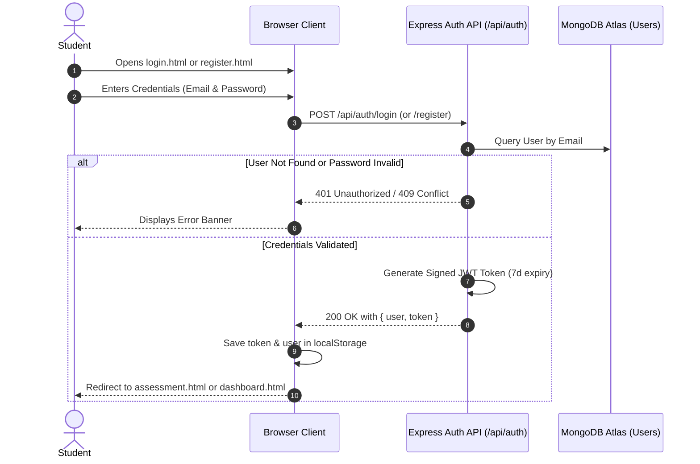
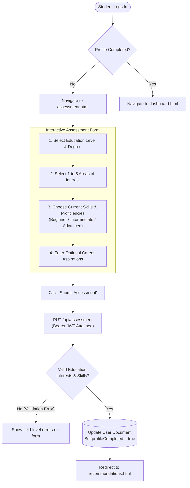
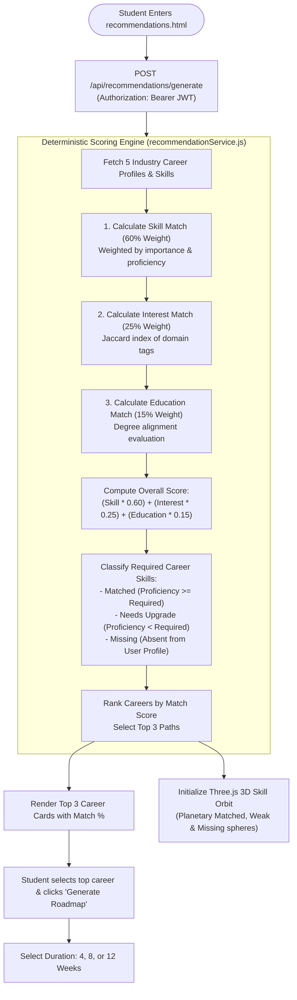
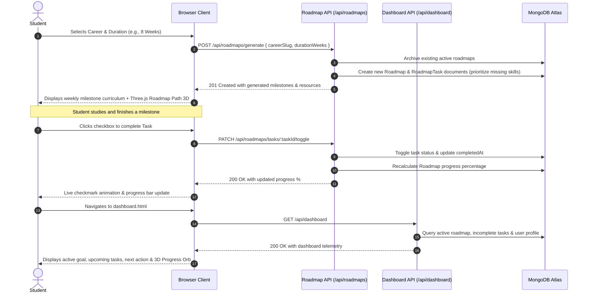

# Application User Flow Diagrams — CareerPath AI

> **Status:** Proposed Application Flow / To be validated during qualifier  
> **Hack2Ignite 2026–27 · Team 404 Brain Not Found**  
> *Discover Your Career. Build Your Skills.*

This document visually illustrates the four primary user flows within CareerPath AI using Mermaid diagrams.

---

## 1. Authentication & Session Flow

---

## 2. Onboarding & Student Assessment Flow

---

## 3. Career Recommendation & Skill-Gap Analysis Flow

---

## 4. Personalized Roadmap & Progress Tracking Flow

