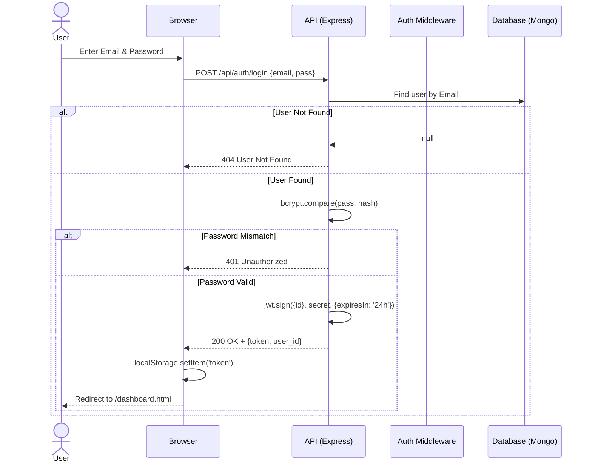
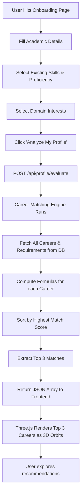
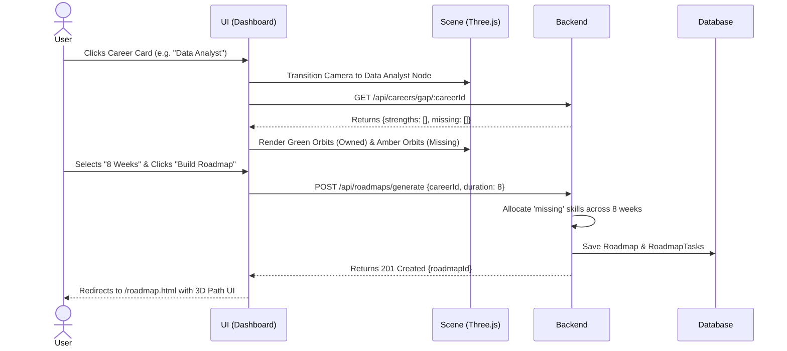

# Application Flow (Detailed)

This document visualizes the exact state transitions for the user. It is critical for the Frontend and Backend teams to understand these flows to ensure API continuity.

---

## 1. Authentication & Session Flow

**Scenario:** A returning user logs in, or a new user registers.
**Edge Cases Handled:** Invalid credentials, duplicate email registration, expired tokens.



---

## 2. Onboarding & Intelligent Matching Flow

**Scenario:** A freshly registered user fills out their profile. The system calculates their path immediately.



---

## 3. Skill-Gap and Roadmap Generation Flow

**Scenario:** The user selects one of the recommended careers and commits to a roadmap.



---

## 4. Weekly Progress Update Flow

**Scenario:** The user marks a specific study resource / tutorial as completed.

```mermaid
flowchart LR
    A[User clicks Checkbox on Task] --> B[Frontend disables checkbox visually]
    B --> C[PUT /api/roadmaps/tasks/:id {isCompleted: true}]
    
    C --> D{API Validator}
    D -- Success --> E[Update Task in DB]
    D -- Fail --> F[Return 400/500 Error]
    F --> G[Frontend reverts checkbox]
    
    E --> H[Backend recalculates overall Roadmap %]
    H --> I[Update Roadmap doc in DB]
    I --> J[Return New % to Frontend]
    
    J --> K[Update DOM Progress Bar]
    K --> L[Update 3D Roadmap Avatar position]
```
