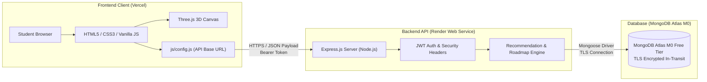

# Cloud Deployment Manual — CareerPath AI

> **Status:** Deployment Guide / To be validated during qualifier  
> **Hack2Ignite 2026–27 · Round 1 MVP**  
> **Domain:** EduTech / AI for Good  
> **Team:** 404 Brain Not Found

---

## 🏗️ Deployment Architecture Overview



---

## 🔄 Deployment Order & Step-by-Step Procedure

To avoid connection failures, execute deployment strictly in this sequence:

```text
Step 1: MongoDB Atlas Cluster  ──►  Step 2: Render Backend Web Service
              │                                      │
              ▼                                      ▼
Step 3: Update Frontend Config ──►  Step 4: Vercel Frontend Deployment
              │                                      │
              ▼                                      ▼
Step 5: Sync Backend CORS      ──►  Step 6: Production Smoke Testing
```

---

## 📋 Environment Variables Reference Table

| Variable Name | Hosting Service | Purpose | Example Placeholder |
| :--- | :--- | :--- | :--- |
| `PORT` | Render / Local `.env` | HTTP listening port | `5000` (Local) / `10000` (Render) |
| `NODE_ENV` | Render / Local `.env` | Runtime environment | `production` |
| `MONGODB_URI` | Render / Local `.env` | MongoDB Atlas TLS connection string | `mongodb+srv://<dbuser>:<dbpassword>@<cluster>.mongodb.net/careerpath-ai?retryWrites=true&w=majority` |
| `JWT_SECRET` | Render / Local `.env` | Secret key for signing and verifying JWTs | `replace_with_a_long_random_64char_string` |
| `JWT_EXPIRES_IN`| Render / Local `.env` | Token validity window | `7d` |
| `CLIENT_URL` | Render / Local `.env` | Authorized frontend origin for CORS | `https://YOUR-APP.vercel.app` (Production) / `http://localhost:5500` (Local) |

---

## 🛠️ Step-by-Step Hosting Instructions

### Step 1 — MongoDB Atlas Free Tier Setup
1. Log in to [MongoDB Atlas](https://www.mongodb.com/cloud/atlas) and create a free **M0** cluster.
2. In **Database Access**, create a user with read/write privileges (e.g., `careerpath_admin`).
3. In **Network Access**, add `0.0.0.0/0` (allow access from anywhere for hackathon demo purposes).
4. Copy the connection string:
   `mongodb+srv://<username>:<password>@<cluster-url>/careerpath-ai?retryWrites=true&w=majority`
5. Seed cloud database locally before first run:
   ```bash
   MONGODB_URI="mongodb+srv://<username>:<password>@<cluster-url>/careerpath-ai?retryWrites=true&w=majority" node server/seed.js
   ```

---

### Step 2 — Backend Deployment on Render
1. Push repository to GitHub.
2. In [Render Dashboard](https://dashboard.render.com/), select **New → Web Service**.
3. Connect your GitHub repository.
4. Set service properties:
   - **Root Directory:** `server`
   - **Runtime:** `Node`
   - **Build Command:** `npm install`
   - **Start Command:** `npm start`
5. Add the environment variables securely on the Render dashboard:
   - `NODE_ENV=production`
   - `MONGODB_URI=<your-atlas-uri>`
   - `JWT_SECRET=<your-jwt-secret>`
   - `JWT_EXPIRES_IN=7d`
   - `CLIENT_URL=https://YOUR-APP.vercel.app` (placeholder until Step 4)
6. Deploy and copy your backend URL: `https://YOUR-RENDER-SERVICE.onrender.com`.
7. Verify health: `GET https://YOUR-RENDER-SERVICE.onrender.com/api/health`.

---

### Step 3 — Update Frontend Configuration
In `client/js/config.js`, replace the production placeholder with your real Render URL:
```javascript
const PRODUCTION_API_URL = 'https://YOUR-RENDER-SERVICE.onrender.com/api';
```

---

### Step 4 — Frontend Deployment on Vercel
1. In [Vercel Dashboard](https://vercel.com/dashboard), click **Add New → Project**.
2. Select your repository.
3. Configure project settings:
   - **Root Directory:** `client`
   - **Framework Preset:** `Other`
   - **Build Command:** *(Leave empty)*
   - **Output Directory:** *(Leave empty / client root)*
4. Click **Deploy**.
5. Copy your deployed production URL: `https://YOUR-APP.vercel.app`.

---

### Step 5 — Synchronize Backend CORS
1. In the Render Dashboard, update `CLIENT_URL` to match your exact Vercel URL: `https://YOUR-APP.vercel.app`.
2. Trigger a manual deploy in Render to apply the updated origin.

---

## ❄️ Render Cold-Start Mitigation (Demo Preparation)

Render free-tier web services spin down after 15 minutes of inactivity. To prevent delays during live evaluation:
1. **Warm-Up Ping:** 5 minutes before your demo, send a GET request to wake the instance:
   ```bash
   curl https://YOUR-RENDER-SERVICE.onrender.com/api/health
   ```
2. Wait 30–60 seconds for the initial cold-start spinup to complete.

---

## 🛡️ Emergency Rollback & Contingency Plan

If cloud hosting experiences latency, network drops, or DNS errors during presentation:

1. **Localhost Demo Failover:**
   - Run backend locally: `npm run dev` in `server/` (`http://localhost:5000`).
   - Serve frontend locally: `python -m http.server 5500` in `client/` (`http://localhost:5500`).
   - `client/js/config.js` automatically detects `localhost` and routes API requests locally without configuration edits.
2. **Postman API Proof:** Import `postman/CareerPath-AI.postman_collection.json` and demonstrate live endpoint responses.
3. **Offline Demo Recording:** Play pre-recorded 1080p MP4 walkthrough video stored in `assets/demo/`.

---

## 🔒 Production Security Checklist

- [ ] All database passwords use URL-encoding for special characters.
- [ ] No real secrets or `.env` files are tracked by Git.
- [ ] Render blueprint `render.yaml` sets `sync: false` on sensitive variables.
- [ ] Vercel sets `X-Content-Type-Options: nosniff` and `X-Frame-Options: DENY`.
- [ ] CORS is restricted to the specific Vercel production origin.
