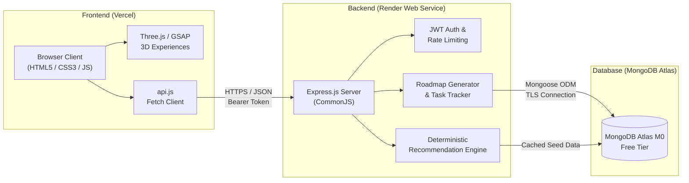

# CareerPath AI — Production Deployment Guide

> **Hack2Ignite 2026–27 · Round 1 MVP**  
> Team: **404 Brain Not Found** · Domain: **EduTech / AI for Good**

---

## 🏗️ Architecture Overview



---

## 📋 Environment Variables Reference

| Variable Name | Location | Purpose | Example Placeholder |
| :--- | :--- | :--- | :--- |
| `PORT` | Render / Local `.env` | HTTP Port for Express Server | `5000` (Local) / `10000` (Render) |
| `NODE_ENV` | Render / Local `.env` | Runtime mode (`development` or `production`) | `production` |
| `MONGODB_URI` | Render / Local `.env` | Connection string to MongoDB cluster | `mongodb+srv://<dbuser>:<dbpassword>@<cluster-name>.mongodb.net/careerpath-ai?retryWrites=true&w=majority` |
| `JWT_SECRET` | Render / Local `.env` | Secret key used to sign and verify JWTs | `replace_with_a_long_random_64char_string` |
| `JWT_EXPIRES_IN`| Render / Local `.env` | Validity period of authentication token | `7d` |
| `CLIENT_URL` | Render / Local `.env` | Allowed CORS origin for browser requests | `https://your-careerpath-app.vercel.app` (Production) / `http://localhost:5500` (Local) |

> ⚠️ **Security Warning:** Never commit `.env` or paste real credentials into source code. Always use Render Dashboard and local `.env` (ignored by Git).

---

## 🔄 Deployment Order & Step-by-Step Procedure

To avoid connection failures, follow this sequence:

```
Step 1: MongoDB Atlas Cluster  ──►  Step 2: Render Backend Web Service
              │                                      │
              ▼                                      ▼
Step 4: Vercel CLIENT_URL Sync ◄──  Step 3: Vercel Frontend Deployment
```

---

### Phase 1: MongoDB Atlas Setup

1. Log into [MongoDB Atlas](https://cloud.mongodb.com).
2. Create a new project named `Hack2Ignite-2026`.
3. Create a **Shared Free Cluster (M0)** (AWS or Google Cloud region closest to your users, e.g. `ap-south-1` Mumbai or `us-east-1`).
4. **Database Access:**
   - Add a database user with username (e.g. `careerpath_admin`) and a strong, randomly generated password.
   - Assign the built-in role: `Read and write to any database`.
5. **Network Access:**
   - Add an IP Access List Entry: `0.0.0.0/0` (Allow access from anywhere, necessary for Render dynamic outbound IPs).
   - Add a description: `Render free tier dynamic egress`.
6. **Connection String:**
   - Click **Connect** → **Drivers** → Node.js.
   - Copy the SRV URI:
     `mongodb+srv://<username>:<password>@<cluster>.mongodb.net/careerpath-ai?retryWrites=true&w=majority`
7. **Local Seed Verification:**
   - Update `server/.env` with your new Atlas URI.
   - Run in your terminal:
     ```powershell
     cd server
     npm run seed
     ```
   - Confirm output: `✅ Successfully seeded 35 skills!` and `✅ Successfully seeded 5 careers!`.

---

### Phase 2: Render Backend Deployment

1. Push your latest code to your GitHub repository.
2. Log into [Render Dashboard](https://dashboard.render.com).
3. Click **New +** → **Web Service**.
4. Connect your GitHub repository.
5. Configure the service settings:
   - **Name:** `careerpath-ai-api` (or custom unique name)
   - **Region:** Oregon (USA) or closest region
   - **Branch:** `master` (or `main`)
   - **Root Directory:** `server`
   - **Runtime:** `Node`
   - **Build Command:** `npm install`
   - **Start Command:** `npm start`
   - **Instance Type:** `Free`
6. Under **Environment Variables**, add:
   - `NODE_ENV` = `production`
   - `MONGODB_URI` = `mongodb+srv://<username>:<password>@<cluster>.mongodb.net/careerpath-ai?retryWrites=true&w=majority`
   - `JWT_SECRET` = `<your-secure-random-jwt-secret>`
   - `JWT_EXPIRES_IN` = `7d`
   - `CLIENT_URL` = `http://localhost:5500` *(temporarily set to localhost, will be updated with Vercel URL in Phase 4)*
7. Click **Create Web Service**.
8. Wait for build and deploy to complete.
9. Verify deployment in browser:
   - Visit: `https://<YOUR-RENDER-SERVICE>.onrender.com/api/health`
   - Expect:
     ```json
     {
       "success": true,
       "message": "CareerPath AI Server is running ✅",
       "version": "1.0.0",
       "team": "404 Brain Not Found"
     }
     ```
   - Visit: `https://<YOUR-RENDER-SERVICE>.onrender.com/api/version`
   - Expect:
     ```json
     {
       "success": true,
       "message": "CareerPath AI API",
       "data": { "version": "1.0.0", "environment": "production" }
     }
     ```

---

### Phase 3: Vercel Frontend Deployment

1. Open [`client/js/config.js`](file:///c:/Users/PARTH/OneDrive/Documents/hackethon/Hack%202%20ignite/demo/client/js/config.js).
2. Update the `PRODUCTION_API_URL` placeholder:
   ```javascript
   const PRODUCTION_API_URL = 'https://<YOUR-RENDER-SERVICE>.onrender.com/api';
   ```
3. Commit and push changes to GitHub:
   ```powershell
   git add client/js/config.js
   git commit -m "chore: point client production config to deployed Render API"
   git push origin master
   ```
4. Log into [Vercel](https://vercel.com).
5. Click **Add New...** → **Project** → Import your GitHub repository.
6. Configure project:
   - **Project Name:** `careerpath-ai`
   - **Framework Preset:** `Other`
   - **Root Directory:** Edit → select `client`
   - **Build and Output Settings:** Leave default (no build command required for vanilla HTML/CSS/JS)
7. Click **Deploy**.
8. Copy your live Vercel URL: `https://<YOUR-VERCEL-APP>.vercel.app`.

---

### Phase 4: CORS Synchronization & Final Polish

1. Return to the [Render Dashboard](https://dashboard.render.com).
2. Open your `careerpath-ai-api` Web Service → **Environment**.
3. Update `CLIENT_URL`:
   - Change from `http://localhost:5500` to `https://<YOUR-VERCEL-APP>.vercel.app`.
4. Click **Save Changes** (Render will automatically redeploy the service with new CORS settings).
5. Verify in browser: Open your Vercel URL, open DevTools (F12) → Console, and verify there are **no CORS errors** during login or assessment submission.

---

## 🛠️ Production Troubleshooting & Cold-Start Mitigation

### 1. Render Free-Tier Cold Starts
- **Behavior:** Render free web services spin down after 15 minutes of inactivity. The first request after idle can take **30–50 seconds** to respond.
- **Hackathon Demo Mitigation:**
  - 5 minutes before your live presentation, open the health check endpoint: `https://<YOUR-RENDER-SERVICE>.onrender.com/api/health` in your browser.
  - This immediately wakes up the Node.js process and warms up the MongoDB connection pool so the demo responds instantly.

### 2. CORS `No 'Access-Control-Allow-Origin' header is present`
- **Root Cause:** The browser origin requesting data does not match `CLIENT_URL` configured on Render.
- **Remedy:** Check Render environment variables → ensure `CLIENT_URL` matches your exact Vercel domain without a trailing slash (e.g. `https://careerpath-ai.vercel.app`, not `https://careerpath-ai.vercel.app/`).

### 3. MongoDB Authentication Failure (`bad auth : Authentication failed`)
- **Root Cause:** Password contains special characters like `@`, `#`, `:`, `%` that break connection string URI parsing.
- **Remedy:** URL-encode the password (e.g. `@` becomes `%40`), or use an alphanumeric-only password for the database user.

---

## 🛡️ Emergency Rollback & Presentation Backup Plan

If live cloud services experience unexpected downtime during the hackathon judging:

1. **Localhost Fallback (Instant Zero-Risk Demo):**
   - Keep local services running in the background:
     - Express API: `http://localhost:5000` (`npm run dev` in `server/`)
     - Frontend client: `http://localhost:5500` (`python -m http.server 5500` in `client/`)
   - The frontend automatically detects `localhost` hostname in `config.js` and routes all requests locally.
2. **Offline WebGL Fallback:**
   - Every 3D canvas container in CareerPath AI (`#careerUniverse`, `#skill-orbit`, `#roadmap-path`, `#progress-orb`) includes automatic WebGL feature detection. If hardware acceleration fails, graceful 2D fallback interfaces render automatically.
3. **API Proof:**
   - Import `postman/CareerPath-AI.postman_collection.json` into Postman to demonstrate all endpoints live if the web UI is inaccessible.
