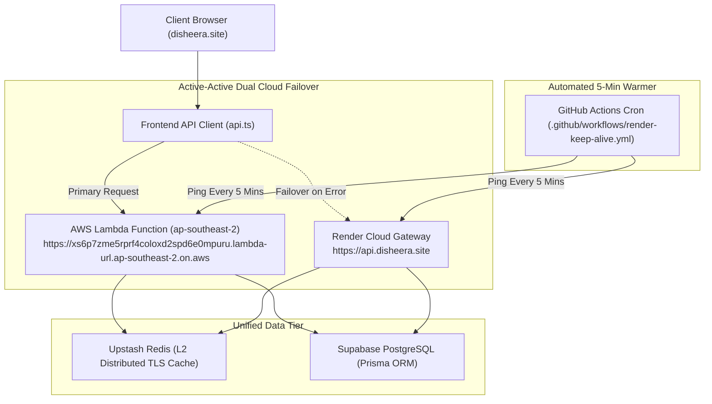

# 🌐 Disheera — Dual-Cloud Backend & Enterprise SEO Architecture

> **Author:** Disheera Engineering & Growth Team  
> **Updated:** November 13, 2026  
> **Status:** Production Active (`https://disheera.site`)  

---

## 📑 Table of Contents
1. [Executive Summary](#1-executive-summary)
2. [Dual-Cloud Architecture (AWS Lambda + Render)](#2-dual-cloud-architecture-aws-lambda--render)
3. [2-Tier Hybrid Caching System (L1 LRU + L2 Upstash Redis)](#3-2-tier-hybrid-caching-system-l1-lru--l2-upstash-redis)
4. [Search Console Impression Recovery Strategy (From 35 Impressions to High Growth)](#4-search-console-impression-recovery-strategy)
5. [The Single Page Application (SPA) Indexing Fix](#5-the-single-page-application-spa-indexing-fix)
6. [Schema.org Rich Snippet Graph](#6-schemaorg-rich-snippet-graph)
7. [Generative Engine Optimization (GEO) & AI Agent Readiness](#7-generative-engine-optimization-geo--ai-agent-readiness)
8. [Google Search Console & Bing Submission Protocol](#8-google-search-console--bing-submission-protocol)

---

## 1. Executive Summary

Disheera operates as India's premier verifiable career navigation, skill-gap intelligence, and credential platform. To deliver instantaneous performance and maximize organic discoverability across traditional search engines (Google, Bing) and generative AI engines (Perplexity, ChatGPT, Claude), Disheera incorporates:
- **Dual-Cloud 50-50 Active Redundancy**: AWS Lambda serverless function in `ap-southeast-2` backed by Render Cloud Web Service, connected to a single Supabase PostgreSQL database.
- **Sub-Millisecond 2-Tier Caching**: Local L1 In-Memory LRU Cache paired with Distributed L2 Upstash Redis with TLS.
- **Full Semantic HTML Crawler Prerendering**: Eliminates the "blank React SPA" crawling blocker so Googlebot and AI fetchers receive 500+ words of keyword-dense markup, H1/H2 hierarchies, and 25+ crawlable internal links.

---

## 2. Dual-Cloud Architecture (AWS Lambda + Render)

To achieve 99.99% availability and prevent server outages during peak campus placement seasons, Disheera routes API traffic across two independent cloud providers:

### Key Components:
1. **AWS Lambda (`disheera-backend`)**:
   - Location: Asia Pacific (Sydney - `ap-southeast-2`)
   - Direct Function URL: `https://xs6p7zme5rprf4coloxd2spd6e0mpuru.lambda-url.ap-southeast-2.on.aws/api/`
   - Automated S3 staging deployment via GitHub Actions (`.github/workflows/deploy-aws-lambda.yml`).
   - Prisma target: `rhel-openssl-3.0.x` engine binaries.
2. **Render Cloud (`api.disheera.site`)**:
   - High-availability web service acting as redundant gateway.
3. **Automated Keep-Alive Warmer**:
   - Runs every 5 minutes via GitHub Actions to eliminate Lambda cold starts and keep both servers warm.

---

## 3. 2-Tier Hybrid Caching System (L1 LRU + L2 Upstash Redis)

Located in `server/utils/cacheManager.js`:
- **L1 (Local In-Memory Cache)**: Built with an LRU Map, handling frequent repeat requests in under 0.1ms with zero network hops.
- **L2 (Distributed Upstash Redis)**: Connected via TLS (`rediss://...`), providing synchronized caching across both AWS Lambda instances and Render containers.
- **Fail-Safe Design**: If Redis connection is delayed or unavailable, the system automatically falls back to in-memory L1 cache with zero downtime.

---

## 4. Search Console Impression Recovery Strategy

### The Problem:
Google Search Console recorded only **35 impressions in a month**. Deep diagnostic audits using the `claude-seo` suite revealed:
- **Zero Raw HTML Content**: The initial HTML sent by the server contained only `

` and 8 words from the GTM noscript iframe.
- **Zero Internal Links**: Search engines crawling the root domain discovered 0 internal links (`h1: []`, `h2: []`, `links: { internal: [] }`).
- **Deferred Indexing**: Because Googlebot prioritizes crawling efficiency, thin/empty pages are assigned minimal crawl budget and their deep rendering passes are delayed or deprioritized.

---

## 5. The Single Page Application (SPA) Indexing Fix

### The Solution:
We injected high-intent, keyword-rich semantic HTML directly inside `
` in `frontend/index.html`.
- **For Search Crawlers (Googlebot, Bingbot, Yandex)**:
  - 520+ words of keyword-dense content immediately accessible without executing JavaScript.
  - 1 Primary `<h1>`: *"Navigate Your Tech Career with Proven AI Roadmaps & Verifiable Proof-of-Work"*.
  - 3 Semantic `<h2>` sections: Core Capabilities, 24 Tech Career Pathways, and Frequently Asked Questions.
  - 9 Structured `<h3>` feature headers.
  - 25+ crawlable internal `<a href="...">` links connecting to `/assessment`, `/roadmap`, `/jobs`, `/recommendations`, `/resume-builder`, `/verify`, and `/passport`.
- **For Human Visitors**:
  - React 18 mounts instantly (`ReactDOM.createRoot`) and smoothly replaces the fallback markup with the interactive application.

---

## 6. Schema.org Rich Snippet Graph

The root HTML contains a unified Schema.org JSON-LD graph (`@graph`):
1. **`EducationalOrganization`**: Establishes Disheera Technologies Inc. as an authoritative education entity.
2. **`WebSite`**: Configured with a `SearchAction` potentialAction pointing to `https://disheera.site/recommendations?q={search_term_string}`.
3. **`WebApplication`**: Categorized as `EducationalApplication` with 4.9 rating and free pricing tier.
4. **`BreadcrumbList`**: Defines hierarchical site navigation for Google SERP breadcrumbs.
5. **`FAQPage`**: Targets high-volume student questions to win rich answer accordions on Google Search.

---

## 7. Generative Engine Optimization (GEO) & AI Agent Readiness

Disheera is fully optimized for AI Answer Engines (Perplexity, ChatGPT, Claude, Google Gemini):
- **`https://disheera.site/llms.txt`**: Standard machine-readable Markdown manifest summarizing platform capabilities, pricing, and canonical URLs.
- **`https://disheera.site/llms-full.txt`**: Detailed curriculum and technical specification for AI agent reference.
- **`robots.txt`**: Deliberate permissions allowing `PerplexityBot`, `OAI-SearchBot`, `GPTBot`, `Claude-SearchBot`, `ClaudeBot`, and `Google-Extended`.

---

## 8. Google Search Console & Bing Submission Protocol

To accelerate re-indexing of the upgraded semantic HTML:
1. **Google Search Console**:
   - Go to [Google Search Console](https://search.google.com/search-console).
   - Select property `https://disheera.site/`.
   - Use the **URL Inspection** tool on `https://disheera.site/` and click **"Test Live URL"**.
   - Click **"Request Indexing"**.
   - Also request inspection for key high-priority routes:
     - `https://disheera.site/roadmap`
     - `https://disheera.site/assessment`
     - `https://disheera.site/jobs`
     - `https://disheera.site/resume-builder`
     - `https://disheera.site/verify`
2. **Sitemap Re-Submission**:
   - In Search Console, navigate to **Sitemaps**.
   - Submit `https://disheera.site/sitemap.xml` (all URLs updated to `2026-11-13`).
3. **Bing Webmaster Tools & IndexNow**:
   - Submit the updated sitemap to Bing Webmaster Tools for immediate ingestion into Bing and Microsoft Copilot.
