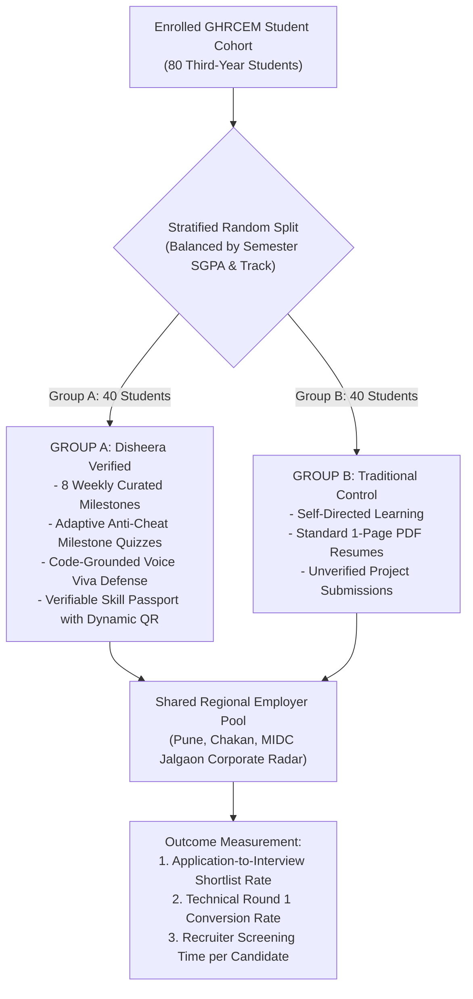

# DISHEERA 8-WEEK BENCHMARK PILOT METHODOLOGY & COHORT PROTOCOL
**Institution:** G.H. Raisoni College of Engineering and Management (GHRCEM), Jalgaon  
**Target Cohort:** 60–80 Computer Engineering & IT Students (Third Year / 6th Semester)  
**License:** AGPL-3.0 (Open-Source Educational Research Protocol)  
**Primary Metric:** Verified Shortlist Delta ($\Delta_{\text{Shortlist}}$)

---

## 1. Executive Summary & Research Hypothesis

The traditional campus recruitment model relies on self-reported PDF resumes containing unsubstantiated claims and buzzwords. Recruiters spend an average of 6–10 seconds glancing at resumes, leading to high false-positive interview shortlists and high rejection rates at technical rounds.

### The Research Hypothesis:
> Candidates presenting a **Disheera Verifiable Skill Passport**—backed by server-proctored adaptive exams, GitHub repository AST code analysis, and a **Code-Grounded Voice Viva**—will achieve a statistically significant higher recruiter interview shortlisting rate than students applying with traditional unverified resumes.

$$\Delta_{\text{Shortlist}} = \text{Shortlist Rate}_{\text{Verified Passport}} - \text{Shortlist Rate}_{\text{Traditional Resume}}$$

---

## 2. Cohort Architecture & Study Design

### Advance Pass / Fail Thresholds:
1. **Shortlist Advantage Benchmark:** Group A must achieve a $\ge 30\%$ higher interview shortlisting rate than Group B across identical job openings.
2. **Milestone Retention Benchmark:** $\ge 65\%$ of enrolled students in Group A complete all 8 weekly milestones.
3. **Employer Trust Benchmark:** $\ge 80\%$ of participating corporate recruiters confirm that the Disheera Skill Passport reduced initial technical screening time.

---

## 3. 8-Week Milestone Progression Schedule

| Week | Milestone Phase | Student Deliverables | Integrity & Proctoring Gates |
| :---: | :--- | :--- | :--- |
| **Week 1** | **Diagnostic Baseline & Stream Alignment** | Diagnostic Assessment, Stream Selection (Full Stack / Cloud / AI), GitHub account linking. | 1:1 Mobile Uniqueness check, GitHub account age & commit verification. |
| **Week 2** | **Foundational Architecture** | Complete Milestone 1 tasks; build modular server or application foundation. | 45-second adaptive quiz, Fisher-Yates server shuffle, velocity anomaly check. |
| **Week 3** | **API Engineering & Data Persistence** | Implement relational database models, relational foreign keys, cascading deletes, transactions. | Anti-cheat code challenge chamber, commit entropy check. |
| **Week 4** | **Security & Boundary Hardening** | Implement JWT authentication, rate limiting middleware, input validation, and password hashing. | Milestone exam with 3-strike tab switch enforcement & 24h lockout. |
| **Week 5** | **Full-Stack State & Live UI** | Build responsive frontend client, asynchronous fetch states, error boundaries, and accessibility tokens. | Automated DOM & lighthouse verification. |
| **Week 6** | **Cloud Deployment & CI/CD** | Containerize application (Docker) or configure automated deployment pipeline (Vercel/Render). | Live health endpoint check, public URL verification. |
| **Week 7** | **Code-Grounded Voice Viva Defense** | Verbal architectural defense session interrogating the student on their own repository code AST. | 15s prep, 45s speech burst, bilingual Hinglish/Marathi keyword tolerance, cryptographic Viva Seal issued. |
| **Week 8** | **Campus Radar & Corporate Shortlisting** | Issue final Verifiable Skill Passport; submit dynamic QR credentials to participating campus recruiters. | Tamper-proof SHA-256 public ledger verification via `verify.html`. |

---

## 4. Student Consent & Privacy Protection (DPDP Act 2023)

In accordance with Section 5 of the Digital Personal Data Protection Act 2023 (Gazette No. 22):
1. **Explicit Notice & Consent:** Students sign an informed digital consent form acknowledging pilot participation and educational research evaluation.
2. **Purpose Limitation:** Student code, quiz attempts, and viva audio transcripts are collected strictly for skill verification, cohort telemetry, and recruiter shortlisting.
3. **Zero Sensitive PII:** Aadhaar numbers, PAN cards, biometric data, financial accounts, and personal browsing history are strictly prohibited and never collected.
4. **Right to Withdraw:** Any student may revoke recruiter sharing at any time while retaining full access to free learning roadmaps.

---

## 5. TPO Placement Cell Dashboard & Data Exports

The TPO placement office at GHRCEM utilizes real-time endpoints provided by Disheera:
- **Live Cohort Roster:** `GET /api/campus/cohort-students` displays all enrolled students, current roadmap week, completion %, and at-risk alerts (>7 days inactive).
- **1-Click Corporate Export:** `GET /api/campus/export-roster-csv` exports a standardized CSV roster formatted with verified skill passport links for visiting corporate recruiters.
