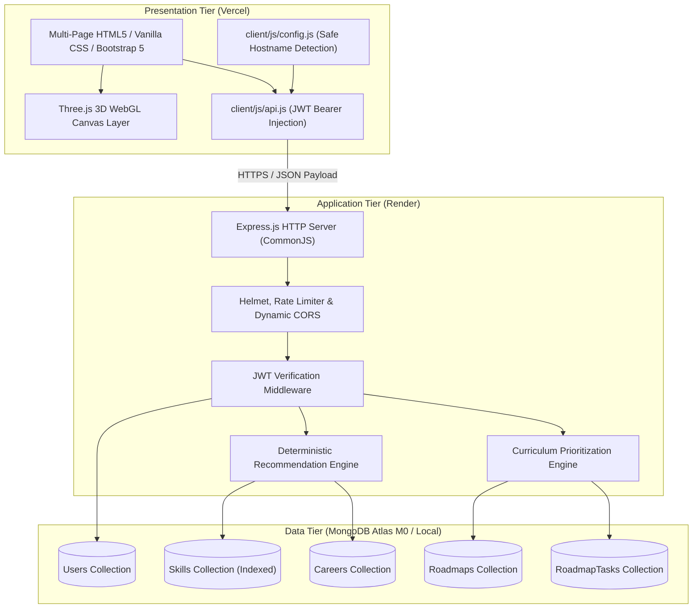

# Technical Requirements Document (TRD) — CareerPath AI

> **Status:** Draft / To be validated during qualifier  
> **Hack2Ignite 2026–27 · Round 1 MVP**  
> **Domain:** EduTech / AI for Good  
> **Team:** 404 Brain Not Found  
> **Primary Author:** Parth Patil (Lead Architect)

---

## 1. System Architecture Overview

CareerPath AI follows a clean decoupled 3-tier web architecture:



---

## 2. Frontend Technical Architecture

- **No Heavy SPA Framework:** Plain HTML5, CSS3, JavaScript (ES6+), and Bootstrap 5.3 to guarantee immediate first-contentful paint without bundle compilation overhead.
- **State Management:** Stateless client architecture utilizing browser `localStorage` for authentication tokens (`careerpath_token`) and cached user summary data.
- **Dynamic Configuration:** Safe environment-aware API URL resolver in `client/js/config.js` toggling between `http://localhost:5000/api` and `https://YOUR-RENDER-SERVICE.onrender.com/api`.
- **API Client:** Centralized fetch wrapper (`client/js/api.js`) automatically attaching `Authorization: Bearer <token>` and handling global 401 token expiry redirects.

---

## 3. Backend Technical Architecture

- **Runtime & Syntax:** Node.js v18+ utilizing native CommonJS (`require` / `module.exports`).
- **Web Framework:** Express.js 4.18+ with modular route controllers.
- **Middleware Pipeline:**
  1. `morgan`: Structured HTTP request logging.
  2. `helmet`: Essential security headers (`X-Content-Type-Options`, `X-Frame-Options`, `Referrer-Policy`).
  3. `cors`: Dynamic origin whitelisting supporting local origins and Vercel domains (`*.vercel.app`).
  4. `express.json`: Body parsing restricted to a 10kb payload limit.
  5. `rateLimit`: Brute-force mitigation on authentication endpoints.
  6. `authMiddleware`: JWT extraction, signature verification, and user injection into `req.user`.
  7. `errorMiddleware`: Centralized error catching and uniform JSON formatting.

---

## 4. Data Models & MongoDB Schema Design

The system implements 5 primary Mongoose schemas:

1. **User Schema (`User.js`):**
   - Credentials: `name`, `email` (unique, lowercase, indexed), `password` (bcrypt salted hash).
   - Subdocuments: `education` (`degree`, `fieldOfStudy`, `graduationYear`), `interests` (array of strings), `skills` (array of `{ name, proficiency }`), `careerGoals`.
   - Metadata: `profileCompleted` (boolean), `createdAt`, `updatedAt`.
2. **Skill Schema (`Skill.js`):**
   - Fields: `name`, `slug` (unique, indexed), `category` (Frontend, Backend, Database, Cloud, Security, Data, Design, Soft Skills), `description`.
3. **Career Schema (`Career.js`):**
   - Fields: `title`, `slug` (unique, indexed), `description`, `requiredSkills` (array of `{ skill: ObjectId, importance: 'high'|'medium'|'low', minimumProficiency: 'beginner'|'intermediate'|'advanced' }`), `preferredEducation`, `industryInterestTags`.
4. **Roadmap Schema (`Roadmap.js`):**
   - Fields: `user` (ref User), `career` (ref Career), `durationWeeks` (4, 8, 12), `status` (`active`, `completed`, `archived`), `progressPercentage`, `totalTasks`, `completedTasks`.
5. **RoadmapTask Schema (`RoadmapTask.js`):**
   - Fields: `roadmap` (ref Roadmap), `user` (ref User), `weekNumber` (integer), `title`, `description`, `skillTag`, `priority`, `resources` (array of `{ title, url, type }`), `completed` (boolean), `completedAt`.

---

## 5. Recommendation Engine Algorithm & Pseudocode

### Scoring Formula
$$\text{Career Match Score} = (\text{Skill Match} \times 0.60) + (\text{Interest Match} \times 0.25) + (\text{Education Match} \times 0.15)$$

### Algorithm Pseudocode

```text
FUNCTION calculateCareerRecommendations(userProfile, allCareers):
    recommendations = []

    FOR EACH career IN allCareers:
        // 1. Skill Match (60%)
        totalSkillPoints = 0
        earnedSkillPoints = 0
        matchedSkills = []
        weakSkills = []
        missingSkills = []

        FOR EACH reqSkill IN career.requiredSkills:
            weight = GET_WEIGHT(reqSkill.importance) // High: 3, Med: 2, Low: 1
            totalSkillPoints += (weight * 3) // Max points at Advanced

            userSkill = FIND_SKILL(userProfile.skills, reqSkill.name)
            IF userSkill EXISTS:
                userScore = GET_PROFICIENCY_SCORE(userSkill.proficiency) // Beg: 1, Int: 2, Adv: 3
                reqScore = GET_PROFICIENCY_SCORE(reqSkill.minimumProficiency)

                earnedSkillPoints += (weight * userScore)

                IF userScore >= reqScore:
                    matchedSkills.PUSH(reqSkill.name)
                ELSE:
                    weakSkills.PUSH(reqSkill.name)
            ELSE:
                missingSkills.PUSH(reqSkill.name)

        skillScorePercentage = (earnedSkillPoints / totalSkillPoints) * 100

        // 2. Interest Match (25%)
        sharedInterests = INTERSECTION(userProfile.interests, career.industryInterestTags)
        interestScorePercentage = (LENGTH(sharedInterests) / MAX(LENGTH(career.industryInterestTags), 1)) * 100

        // 3. Education Match (15%)
        educationScorePercentage = EVALUATE_EDUCATION(userProfile.education.degree, career.preferredEducation)

        // Weighted Overall Score
        matchScore = ROUND((skillScorePercentage * 0.60) + (interestScorePercentage * 0.25) + (educationScorePercentage * 0.15))

        recommendations.PUSH({
            career: career,
            matchScore: matchScore,
            scoreBreakdown: { skill: skillScorePercentage, interest: interestScorePercentage, education: educationScorePercentage },
            skillGap: { matched: matchedSkills, weak: weakSkills, missing: missingSkills }
        })

    SORT recommendations BY matchScore DESCENDING
    RETURN FIRST_3(recommendations)
```

---

## 6. 3D WebGL Architecture (Three.js + GSAP)

1. **Three.js WebGL Renderer:**
   - Antialiasing enabled, transparent background, adaptive device pixel ratio capped at `Math.min(window.devicePixelRatio, 2)` for power efficiency.
2. **Animation Loop & Memory Management:**
   - RAF (`requestAnimationFrame`) with frame-delta throttling.
   - Resize listeners updating camera aspect ratios and renderer dimensions dynamically.
   - Explicit cleanup methods disposing of geometries, materials, and textures to prevent browser memory leaks.
3. **Graceful Degradation:**
   - Every 3D script checks `window.WebGLRenderingContext` before mounting.
   - If WebGL initialization fails, the script unhides pre-rendered **2D HTML/CSS cards** and logs a diagnostic message without halting script execution.

---

## 7. Quality Assurance & Deployment Strategy

- **Manual QA Matrix:** 19 structured test cases spanning Authentication, Assessment, Recommendations, Roadmaps, Tasks, and Security guards (`docs/TESTING.md`).
- **Postman Collection:** Comprehensive Postman v2.1 collection with collection variables and automated JWT storage (`postman/CareerPath-AI.postman_collection.json`).
- **Continuous Hosting:**
  - **Frontend:** Vercel multi-page deployment configured via `client/vercel.json`.
  - **Backend:** Render Node Web Service deployment configured via `server/render.yaml`.
  - **Database:** MongoDB Atlas M0 cluster with TLS encryption in transit.
