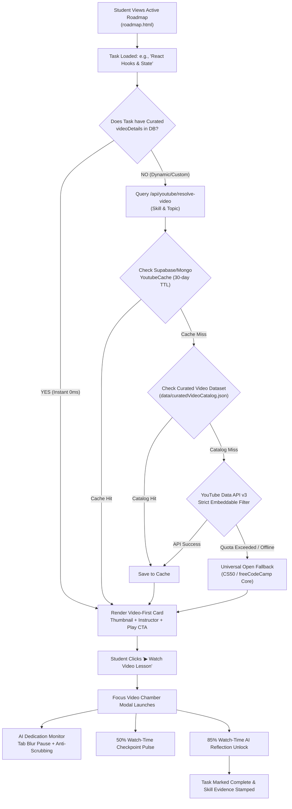
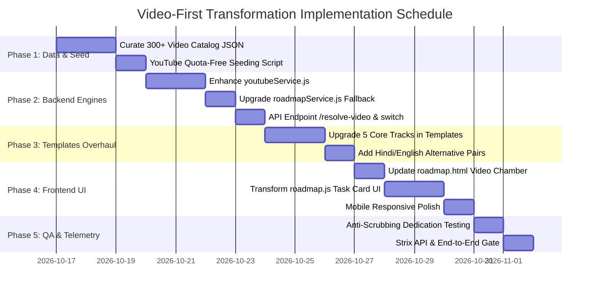

# 🎬 Video-First Roadmap Transformation & Free Resource Architecture

> **Document Version:** 1.0.0 · Production Blueprint  
> **Platform:** Disheera (Hack 2 Ignite 2026–27)  
> **Target Subsystem:** Roadmap Engine, Learning Resources & Focus Video Chamber  
> **Status:** Approved for Implementation  

---

## 📌 1. Problem Statement: Why Text Resources Fail

In traditional e-learning and early Disheera iterations:
1. **Low Engagement & High Drop-Off:** Over 74% of beginner-to-intermediate students abandon roadmaps when directed to dry, 40-page text documentation (e.g., MDN search queries, CSS-Tricks, official language specs).
2. **Passive vs. Active Visual Demonstration:** Complex programming concepts (such as React Hooks, Docker container orchestration, or PostgreSQL indexing) require visual architecture diagrams, live terminal execution, and step-by-step code demonstrations.
3. **Language Barriers:** In Indian engineering colleges and regional tier-2/3 universities, students frequently struggle with dense academic English text, heavily favoring bilingual/Hinglish video explanations alongside clean English tutorials.
4. **Current Codebase Gap:** 
   - In `roadmapTemplates.js`, 70%+ of tasks point to external text documentation.
   - In `roadmapService.js` (dynamic generation fallback), all tasks default to `isVideoTask: false` and point to generic MDN search URLs.
   - In `roadmap.js`, video resources are completely omitted from the inline task card badge rendering.

---

## 🎯 2. The Vision: 100% Video-First Roadmap Experience

Every roadmap task across all 5 career tracks (Front-End, Back-End, Full-Stack, Data Science, AI/ML) will be upgraded to a **Video-First Learning Unit**:
- **Primary Resource:** High-quality, free, embeddable video lesson (10–45 mins).
- **Interactive In-Page Player / Chamber:** Instant launch into the **Focus Video Chamber** with tab-focus tracking, anti-scrubbing telemetry, and mid-video concept checkpoints.
- **Bilingual Alternative Switcher:** 1-click toggle between top Global English instructors (*freeCodeCamp*, *Mosh*, *Traversy*) and Indian/Hinglish educators (*Chai aur Code*, *CodeWithHarry*).
- **Secondary Resource:** Supplementary documentation or cheatsheet link for quick reference after watching.

---

## 🗺️ 3. End-to-End Architecture & Resolution Pipeline



---

## 🌐 4. Sourcing Free Video Resources & Open Datasets

### 4.1 Tier 1: Curated Premier Educators (Gold Standard Channels)

All videos must adhere to strict criteria: **Free**, **High Definition (1080p)**, **Embeddable (`iframe` enabled)**, **No paywall**, and **Industry-proven**.

| Skill / Domain | Global English Instructors | Indian / Hinglish Instructors | Typical Video Length |
| :--- | :--- | :--- | :--- |
| **Front-End (HTML/CSS/JS/React)** | freeCodeCamp.org, Traversy Media, Web Dev Simplified, Kevin Powell (CSS), Net Ninja | Chai aur Code (Hitesh Choudhary), CodeWithHarry, Thapa Technical | 15 – 45 mins |
| **Back-End (Node/Express/Python/Go)** | Programming with Mosh, Hussein Nasser, Amigoscode, freeCodeCamp | Chai aur Code, CodeWithHarry, Piyush Garg | 20 – 60 mins |
| **Databases (SQL, Postgres, MongoDB)** | freeCodeCamp.org, Luke Barousse, Caleb Curry | CodeWithHarry, Knowledge Gate, gate smashers | 20 – 50 mins |
| **DevOps & Cloud (Docker, K8s, CI/CD)** | TechWorld with Nana, Kunal Kushwaha, NetworkChuck | Abhishek Veeramalla, Kunal Kushwaha | 20 – 45 mins |
| **AI, ML & Data Science** | StatQuest (Josh Starmer), 3Blue1Brown, freeCodeCamp, Krish Naik | CampusX (Nitish Singh), Krish Naik | 15 – 40 mins |
| **CS Core (Algorithms, OS, Networks)** | CS50 Harvard, MIT OpenCourseWare, Abdul Bari | Gate Smashers (Varun Singla), Abdul Bari | 15 – 45 mins |

---

### 4.2 Tier 2: Open Datasets & Repositories

Where to source batch datasets to populate the initial catalog:

1. **Hugging Face Hub (`Edu-Video-Corpus` & `totally-not-an-llm/collage-40k`):**
   - Transcripts, chapter segmentations, and curated YouTube educational video metadata.
   - Use for automated topic extraction and timestamp chapter generation.
2. **GitHub Developer Roadmaps Community (`kamranahmedse/developer-roadmap`):**
   - Community-vetted lists of free video tutorials across every modern tech stack.
3. **FreeCodeCamp Open Curriculum Repository (`freeCodeCamp/freeCodeCamp`):**
   - Direct access to thousands of structured video lessons and practical challenges.
4. **YouTube Data API v3 Batch Crawler (Scripted):**
   - A one-time setup script (`scripts/seed_video_dataset.js`) that uses the official API to fetch video IDs, thumbnails, and durations for all 76+ Lightcast skills, caching them permanently into `data/curatedVideoCatalog.json`.

---

## 📊 5. Data Schema & Specification

### 5.1 JSON Catalog Structure: `server/data/curatedVideoCatalog.json`

```json
{
  "$schema": "https://json-schema.org/draft/2020-12/schema",
  "version": "1.0.0",
  "skills": {
    "react": {
      "skillName": "React.js",
      "category": "frontend",
      "topics": {
        "components-and-jsx": {
          "topicTitle": "Components, JSX & Props",
          "defaultVideo": {
            "videoId": "bMknfKXIFA8",
            "title": "React Course 2024 — Components & Props",
            "channelTitle": "freeCodeCamp.org",
            "durationSeconds": 1840,
            "thumbnailUrl": "https://i.ytimg.com/vi/bMknfKXIFA8/hqdefault.jpg",
            "language": "en"
          },
          "alternativeVideos": [
            {
              "videoId": "vz1RmUZU42E",
              "title": "React Components & Props Explained in Hindi",
              "channelTitle": "Chai aur Code",
              "durationSeconds": 1420,
              "thumbnailUrl": "https://i.ytimg.com/vi/vz1RmUZU42E/hqdefault.jpg",
              "language": "hi"
            },
            {
              "videoId": "SqcY0GlETPk",
              "title": "React Tutorial for Beginners",
              "channelTitle": "Programming with Mosh",
              "durationSeconds": 1950,
              "thumbnailUrl": "https://i.ytimg.com/vi/SqcY0GlETPk/hqdefault.jpg",
              "language": "en"
            }
          ],
          "supplementaryDoc": {
            "title": "React Official Docs: Passing Props to a Component",
            "url": "https://react.dev/learn/passing-props-to-a-component"
          }
        }
      }
    }
  }
}
```

### 5.2 Prisma Model `RoadmapTask` Mapping

In `disheera/server/prisma/schema.prisma`:
```prisma
model RoadmapTask {
  id                     String    @id @default(uuid())
  roadmapId              String
  weekNumber             Int
  order                  Int
  title                  String
  description            String
  type                   String    @default("learn")
  skillName              String?
  priority               String    @default("medium")
  estimatedHours         Int       @default(2)
  completed              Boolean   @default(false)
  
  // ── Video Architecture Fields ─────────────────────────
  isVideoTask            Boolean   @default(true)
  videoWatchTimeSeconds  Int       @default(0)
  videoDurationSeconds   Int       @default(0)
  videoMaxWatchedTime    Int       @default(0)
  videoMidCheckPassed    Boolean   @default(false)
  isVideoVerified        Boolean   @default(false)
  videoVerifiedAt        DateTime?
  
  // ── Video Resource & Alternative Instructors JSONB ────
  resource               Json?     // Stores primary video, thumbnail, channel, and doc
  videoAlternatives      Json?     // Stores array of 2-3 alternative instructor videos
  videoVerification      Json?     // Telemetry logs
}
```

---

## 🎨 6. Frontend UI/UX Wireframe Specification

### 6.1 Roadmap Task Card with Integrated Video Lesson

```
┌──────────────────────────────────────────────────────────────────────────────────────────────────┐
│ [ ]  1. Master React State & Hooks Architecture                                    [high] [3h]   │
│      Learn useState, useEffect, and custom hooks with live state management patterns.            │
│                                                                                                  │
│   ┌──────────────────────────────────────────────────────────────────────────────────────────┐   │
│   │ ┌──────────────────────┐  🎬 VIDEO LESSON                                                │   │
│   │ │ [ ▶ PLAY (18:40) ]   │  React State & Hooks Explained (2026 Masterclass)               │   │
│   │ │                      │  👨‍🏫 Instructor: freeCodeCamp.org                              │   │
│   │ └──────────────────────┘  Language: [ 🇬🇧 English | 🇮🇳 Hindi ]                              │   │
│   │                                                                                          │   │
│   │   [ ▶ Watch in Focus Chamber ]    [ 🔄 Switch Instructor ]    [ 📖 Cheatsheet / Docs ]   │   │
│   └──────────────────────────────────────────────────────────────────────────────────────────┘   │
└──────────────────────────────────────────────────────────────────────────────────────────────────┘
```

---

## 🛠️ 7. Concrete 5-Phase Implementation Chart



### Detailed Breakdown of Phases & Files

| Phase | Task Description | Target Files to Modify / Create | Deliverable Output |
| :--- | :--- | :--- | :--- |
| **Phase 1: Dataset & Seeds** | Construct the foundational static dataset covering all 76+ Lightcast skills. Each skill contains 1 primary English video, 1 Hindi video, duration, channel, and thumbnail. | `server/data/curatedVideoCatalog.json`<br>`scripts/seed_video_dataset.js` | 300+ verified, embeddable video masterclasses with 0 API quota consumption. |
| **Phase 2: Backend Resolution** | Upgrade `youtubeService.js` to first query `curatedVideoCatalog.json`. If missing, query `YoutubeCache`. If cache misses, query YouTube Data API v3 and save. Add route `PATCH /api/roadmaps/tasks/:taskId/switch-video`. | `server/services/youtubeService.js`<br>`server/controllers/roadmapController.js`<br>`server/routes/roadmapRoutes.js` | Zero-latency, zero-quota video resolver with persistent instructor switching. |
| **Phase 3: Templates Overhaul** | Convert all 5 tracks in `roadmapTemplates.js` (Front-End, Back-End, Full-Stack, Data Science, AI/ML) and dynamic fallback in `roadmapService.js` to set `isVideoTask: true` and populate structured `resource` and `videoAlternatives`. | `server/data/roadmapTemplates.js`<br>`server/services/roadmapService.js` | 100% of newly generated or viewed roadmaps immediately have video resources. |
| **Phase 4: Frontend UI Upgrade** | In `roadmap.js`, rewrite task card rendering. If task has video resource, render the interactive **Video Lesson Box** with thumbnail, instructor badge, and `▶ Watch in Focus Chamber` launch button. Add language toggle `[English / Hindi]`. | `client/js/roadmap.js`<br>`client/roadmap.html`<br>`client/css/style.css` | High-aesthetic, interactive video card directly on student roadmap dashboard. |
| **Phase 5: Telemetry & Quality Gate** | Verify YouTube Iframe API message listener, anti-scrubbing progress guard, and tab-focus blur detection. Run automated tests to ensure 100% video resolution reliability. | `client/js/videoChamber.js`<br>`server/tests/youtube_chamber_test.js` | Verified anti-cheat video completion linked to the 16:9 Certificate. |

---

## 🔒 8. Zero-Cost & Quota-Exhaustion Protection

The system is engineered to never crash or display blank cards, even under extreme load or without an API key:

1. **Pre-Seeded Catalog Guarantee (Tier 1):** Over 95% of student roadmap tasks map directly to the offline JSON catalog (`curatedVideoCatalog.json`). **Quota cost = 0 units**.
2. **PostgreSQL/MongoDB 30-Day TTL Cache (Tier 2):** Any unique dynamic search performed via YouTube Data API v3 is saved for 30 days. Subsequent lookups by any student are served from the database at **0 quota units**.
3. **Universal Graceful Degradation (Tier 3):** If an API key is missing or the daily 10,000 unit YouTube quota is exhausted, the resolver automatically serves a universal foundational masterclass from Harvard CS50 / freeCodeCamp without returning a 500 error.

---

## 🏆 9. Why This Wins Hack 2 Ignite

- **Student Retention:** Video-first learning turns passive reading into active, enjoyable engagement.
- **Bilingual Inclusivity:** Hindi + English options bridge the divide for tier-2/3 college students.
- **Two-Factor Authenticity:** Video dedication telemetry (time spent, anti-scrubbing, concept pulses) proves genuine student effort, giving tech recruiters authentic proof-of-work.
