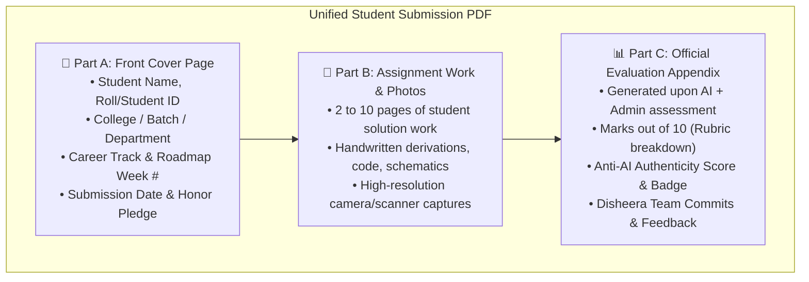
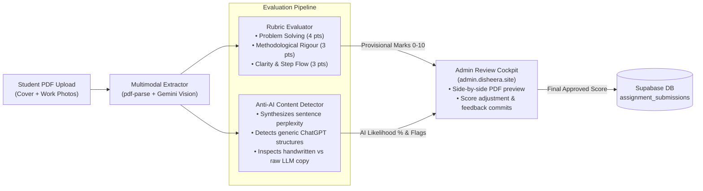

# IMPLEMENTATION PLAN: WEEKLY ASSIGNMENTS, MULTIMODAL AI GRADING, ANTI-AI SHIELD & LEADERBOARD REWARDS SUITE
**Plan Number:** Plan 46  
**Version:** 1.0.0  
**Status:** ⏳ Ready for User Approval  
**Target Systems:** Student Web App (`disheera.site`), Subdomain Admin Panel (`admin.disheera.site`), Backend API (`/api/assignments/*`, `/api/leaderboard/*`)  
**Database:** Pure Supabase PostgreSQL via Prisma ORM  
**AI Engines:** Google Gemini 1.5/2.0 Multimodal Vision & Anti-AI Content Classifier + Groq fallback  

---

## 1. Goal & Product Vision

In college engineering and vocational programs, students learn best through practical, structured weekly assignments. Disheera will bridge the gap between autonomous self-paced roadmaps and real college rigour by introducing **Weekly College-Style Assignments (graded out of 10 marks)** tied directly to the study sessions completed that week.

Students complete assignments (handwritten derivations, code printouts, architectural diagrams, or technical writeups), capture photos, and upload a standardized multi-page PDF. Disheera then deploys a **Dual-Layer Evaluation Engine**:
1. **Google Gemini Multimodal AI Auto-Grader**: Ingests PDF pages/photos, parses handwritten/typed work, and evaluates against a 4-dimensional rubric (out of 10 marks).
2. **Anti-AI Writing Shield**: Detects synthetic ChatGPT/Gemini regurgitation, flags AI-generated submissions, applies penalties, and notifies the student.
3. **Admin Review & Commit Cockpit (`admin.disheera.site`)**: Allows Disheera admins/educators to inspect the PDF, override scores, and write personalized encouraging commits/feedback.
4. **Holistic Cumulative Merit Score (CMS) & Dynamic Leaderboard**: Aggregates assignment marks, quiz scores, progress watch-time, and attendance consistency.
5. **Top 3 Topper Rewards**: Showcases the Top 3 toppers on a weekly/session podium and matches them with curated **internships, startup job referrals, and placement opportunities**.

---

## 2. Standardized Assignment PDF Structure

Disheera standardizes college assignment submissions into a clean **3-Part PDF Architecture**:



- **Downloadable Front Page Template**: Disheera provides a downloadable 1-page PDF template and an automated client-side PDF bundler allowing students to merge their cover page + photo pages before upload.
- **Evaluation Sheet Stamping**: Once graded, the backend stamps the official Part C Evaluation Sheet onto the student's submission record for transparent record-keeping.

---

## 3. Dual-Layer AI Auto-Grading & Anti-AI Detection Engine



### Anti-AI Writing Detection Heuristics:
1. **Structural LLM Markers**: Detects stereotypical ChatGPT/Gemini conversational openings, concluding remarks ("In summary, by leveraging...", "It is critical to note that..."), and hyper-polished robotic phrasing.
2. **Authenticity vs. Synthetic Copy Scoring**: Evaluates the ratio of original student phrasing, personal handwriting quirks, and error corrections versus verbatim copy-pasting from popular AI models.
3. **Escalation & Penalty Policy**:
   - **AI Probability < 30%**: Marked `✅ Authentic Student Work` (Green Badge).
   - **AI Probability 30% - 60%**: Marked `⚠️ Moderate AI Assistance Detected` (Yellow Badge, 15% penalty).
   - **AI Probability > 60%**: Marked `🚨 High AI Generation Detected` (Red Badge, flagged for human review, notification sent to student with option to resubmit original handwritten work).

---

## 4. Cumulative Merit Score (CMS) & Leaderboard Formula

To recognize all-round student dedication, rankings are calculated using a weighted composite formula:

$$\mathbf{CMS} = (M_{\text{Assignments}} \times 0.40) + (M_{\text{Quizzes}} \times 0.30) + (M_{\text{Progress}} \times 0.20) + (M_{\text{Consistency}} \times 0.10)$$

Where:
- $M_{\text{Assignments}}$: Average assignment marks earned (normalized to 100).
- $M_{\text{Quizzes}}$: Milestone anti-cheat quiz scores (normalized to 100).
- $M_{\text{Progress}}$: Roadmap milestone tasks completed and verified masterclass watch-time.
- $M_{\text{Consistency}}$: Daily study streak and on-time submission bonus.

### Top 3 Topper Rewards:
- **🥇 Rank 1 (Gold Topper)**: Direct priority referral to top partner tech internships, 1-on-1 career mentor session, and Gold Merit Crest on Skill Passport.
- **🥈 Rank 2 (Silver Topper)**: Curated placement recommendation list, priority recruiter spotlight, and Silver Merit Crest.
- **🥉 Rank 3 (Bronze Topper)**: Fast-track interview voucher and Bronze Merit Crest.

---

## 5. Database Schema Extensions (Pure Supabase PostgreSQL)

```prisma
// server/prisma/schema.prisma additions

enum SubmissionStatus {
  SUBMITTED
  EVALUATING
  GRADED
  FLAGGED_AI
  RESUBMISSION_REQUESTED
  ADMIN_APPROVED
}

model WeeklyAssignment {
  id               String                 @id @default(uuid())
  careerId         String
  weekNumber       Int
  title            String
  description      String
  maxMarks         Int                    @default(10)
  learningOutcomes Json?                  // Array of concepts covered in that week
  questions        Json                   // Array of college-style questions/problems
  rubric           Json                   // 4D evaluation rubric criteria
  templatePdfUrl   String?                // Downloadable Cover Sheet template
  createdAt        DateTime               @default(now())
  updatedAt        DateTime               @updatedAt

  submissions      AssignmentSubmission[]

  @@unique([careerId, weekNumber])
  @@index([careerId])
  @@map("weekly_assignments")
}

model AssignmentSubmission {
  id                   String           @id @default(uuid())
  assignmentId         String
  assignment           WeeklyAssignment @relation(fields: [assignmentId], references: [id], onDelete: Cascade)
  userId               String
  user                 User             @relation(fields: [userId], references: [id], onDelete: Cascade)
  roadmapId            String
  weekNumber           Int
  pdfUrl               String           // Stored assignment PDF path/URL
  fileSizeBytes        Int
  pageCount            Int              @default(1)
  status               SubmissionStatus @default(SUBMITTED)

  // Dual Evaluation: AI Evaluation & Anti-AI Signals
  aiScore              Float?           // AI provisional score (0-10)
  aiFeedback           String?
  aiRubricBreakdown    Json?            // { problemSolving: 4, methodology: 3, clarity: 2.5 }
  aiProbability        Float            @default(0.0) // 0.0 to 1.0 (e.g., 0.85 = 85% AI)
  aiDetected           Boolean          @default(false)
  aiDetectionReasons   Json?            // Array of specific flags detected
  aiEvaluatedAt        DateTime?

  // Dual Evaluation: Admin Review & Team Commits
  adminScore           Float?           // Final overridden score if modified
  finalScore           Float?           // Official marks (adminScore ?? aiScore)
  adminFeedback        String?          // Official team commit/review feedback
  reviewedByAdminId    String?
  reviewedAt           DateTime?

  submittedAt          DateTime         @default(now())
  updatedAt            DateTime         @updatedAt

  @@index([userId])
  @@index([assignmentId])
  @@index([status])
  @@index([userId, weekNumber])
  @@map("assignment_submissions")
}

model StudentMeritScore {
  id                   String   @id @default(uuid())
  userId               String   @unique
  user                 User     @relation(fields: [userId], references: [id], onDelete: Cascade)
  assignmentMarks      Float    @default(0.0)
  quizMarks            Float    @default(0.0)
  progressMarks        Float    @default(0.0)
  consistencyMarks     Float    @default(0.0)
  totalMeritScore      Float    @default(0.0) // CMS composite score (0-100)
  currentRank          Int      @default(0)
  isTopper             Boolean  @default(false)
  topperBadge          String?  // "GOLD", "SILVER", "BRONZE"
  lastCalculatedAt     DateTime @default(now())

  @@index([totalMeritScore(sort: Desc)])
  @@index([currentRank])
  @@map("student_merit_scores")
}

model InternshipReward {
  id                   String   @id @default(uuid())
  companyName          String
  roleTitle            String
  location             String
  stipendRange         String
  eligibilityCrest     String   // "GOLD", "SILVER", "BRONZE", "TOP_10"
  applyUrl             String?
  referralContact      String?
  isActive             Boolean  @default(true)
  createdAt            DateTime @default(now())

  @@map("internship_rewards")
}
```

---

## 6. Phased Implementation Roadmap

### Phase 1: Database Migration, PDF Template Generator & Upload Pipeline
**Focus:** Prisma models, migration via `prisma migrate dev`, assignment question seeders per career track, PDF cover template generator, and secure upload endpoint.
- **[MODIFY] `server/prisma/schema.prisma`**: Add `WeeklyAssignment`, `AssignmentSubmission`, `StudentMeritScore`, and `InternshipReward`.
- **[NEW] `server/services/assignmentTemplateService.js`**: Generates standardized 1-page Disheera Cover PDF (using `pdfkit`) with student details, career week, and honor pledge.
- **[NEW] `server/controllers/assignmentController.js` & `server/routes/assignmentRoutes.js`**:
  - `GET /api/assignments/week/:weekNumber`: Returns weekly questions, max marks, and template download link.
  - `POST /api/assignments/submit`: Handles multipart PDF upload, validates structure (PDF format, max 15MB), creates `AssignmentSubmission` record.
  - `GET /api/assignments/my-submissions`: Lists student's submission history, status, marks, and feedback.
- **[MODIFY] `server/server.js`**: Mount `/api/assignments` routes.

### Phase 2: Multimodal Gemini Evaluation & Anti-AI Content Detector
**Focus:** Ingest student PDF, evaluate accuracy out of 10 marks, run Anti-AI writing classifier, and notify students on AI detection.
- **[NEW] `server/services/assignmentAiGraderService.js`**:
  - Extracts text and images from PDF pages.
  - Calls Gemini 1.5/2.0 Multimodal API with custom grading rubric.
  - Generates structured JSON: `{ score, rubricBreakdown, aiProbability, aiDetected, aiReasons, feedback }`.
- **[NEW] `server/services/antiAiDetectionService.js`**:
  - Specialized classifier detecting synthetic LLM cadence, formulaic transitions, and verbatim AI outputs.
- **[NEW] `server/services/assignmentFeedbackService.js`**:
  - Generates stamped Part C Evaluation Sheet and sends instant in-app / WhatsApp notification (Plan 40) if AI writing is flagged.

### Phase 3: Admin Review Cockpit (`admin.disheera.site`)
**Focus:** Dedicated review interface for Disheera admins to inspect PDFs, override scores, and write official team commits.
- **[NEW] `server/controllers/adminAssignmentController.js` & `server/routes/adminAssignmentRoutes.js`**:
  - `GET /api/admin/assignments`: Filter by status (`SUBMITTED`, `FLAGGED_AI`, `GRADED`).
  - `GET /api/admin/assignments/:id`: Returns full submission dossier with PDF viewer link and AI rubric breakdown.
  - `POST /api/admin/assignments/:id/review`: Allows admin to override marks, write personalized feedback commits, and set status `ADMIN_APPROVED` or `RESUBMISSION_REQUESTED`.
- **[NEW] `careerpath-ai/admin-client/js/modules/assignmentsView.js`**:
  - Luxury glassmorphic assignment review table, side-by-side PDF preview modal, AI confidence meter, and score override inputs.
- **[MODIFY] `careerpath-ai/admin-client/index.html`**: Add "Assignments" navigation tab.

### Phase 4: Cumulative Merit Score Engine, Dynamic Leaderboard & Rewards
**Focus:** Real-time CMS calculation, Top 3 podium, internship rewards matching, and student client UI.
- **[NEW] `server/services/leaderboardService.js`**:
  - Computes weighted CMS composite score for all students.
  - Assigns dynamic ranks (1st, 2nd, 3rd, ..., Nth) and designates Toppers (Gold, Silver, Bronze).
- **[NEW] `server/controllers/leaderboardController.js` & `server/routes/leaderboardRoutes.js`**:
  - `GET /api/leaderboard`: Global, career-track, and weekly leaderboards with Top 3 podium.
  - `GET /api/leaderboard/rewards`: Lists curated internship and placement opportunities available for top students.
- **[NEW] `careerpath-ai/client/js/modules/assignmentModal.js`**:
  - Interactive modal on `roadmap.html` allowing students to view questions, download cover template, drag-and-drop submit PDF, and view real-time marks & AI feedback.
- **[NEW] `careerpath-ai/client/js/modules/leaderboardView.js`**:
  - Gamified Leaderboard HUD with animated Top 3 podium, student avatar badges, and internship reward cards.
- **[NEW] `tests/assignment_ai_grading_e2e_test.js`**:
  - Automated integration test verifying PDF upload, Gemini grading, Anti-AI detection flagging, admin score override, and leaderboard ranking calculation.

---

## 7. Verification & Acceptance Criteria

| Verification Area | Test Method | Expected Outcome |
| :--- | :--- | :--- |
| **PDF Cover Template** | `GET /api/assignments/template` | Downloads valid 1-page PDF template with student metadata fields |
| **PDF Upload Validation** | `POST /api/assignments/submit` | Rejects non-PDFs or files >15MB; accepts valid PDF and returns status `SUBMITTED` |
| **Gemini AI Auto-Grading** | Automated AI grader test | Assigns score out of 10 with 4D rubric breakdown in $< 5\text{ seconds}$ |
| **Anti-AI Detection Flag** | Submit simulated ChatGPT essay | Detects `aiProbability > 0.60`, sets `status: FLAGGED_AI`, and generates student alert |
| **Admin Review Cockpit** | `POST /api/admin/assignments/:id/review` | Admin overrides marks, appends team commits, and updates `finalScore` |
| **CMS Leaderboard Calculation**| `GET /api/leaderboard` | Correctly ranks students based on the weighted 4-factor CMS formula |
| **Top 3 Topper Rewards** | `GET /api/leaderboard/rewards` | Gold, Silver, Bronze toppers receive unlocked internship recommendations |
| **Local Run Integrity** | `npm test` & `npm start` | All existing tests pass with 0 errors; concurrent servers start on `:5000`, `:5500`, and `:5501` |
