# Disheera — Google Stitch Generated Screens & Code Catalog

> **Stitch Project**: Diseera  
> **Project ID**: `11810202549174231352`  
> **Downloaded Output Path**: [`stitch_screens/`](file:///c:/Users/PARTH/OneDrive/Documents/hackethon/Hack%202%20ignite/CareerPath%20AI/disheera/stitch_screens)

All 12 project screens have been successfully retrieved from Google Stitch (`stitch.withgoogle.com`) and saved into the codebase with high-resolution screenshots and complete, production-grade Tailwind CSS/HTML templates.

---

## Screen Directory & Assets Summary

| # | Screen Name & ID | Dimensions | Code File (HTML) | Image Screenshot (PNG) |
|---|---|---|---|---|
| **01** | **Autonomous Career GPS & Institutional Verification**<br>`3d71188264c147ffa254b4d608ce1ea4` | 2560 × 6086 | [01_landing_route_map.html](code/01_landing_route_map.html) (42 KB) | [01_landing_route_map.png](images/01_landing_route_map.png) (60 KB) |
| **02** | **Clean Auth & 2-Step WhatsApp Verification Modal**<br>`fb73d5e75aa94ee6b2b61906b3626ea1` | 2560 × 2742 | [02_clean_auth_whatsapp_modal.html](code/02_clean_auth_whatsapp_modal.html) (35 KB) | [02_clean_auth_whatsapp_modal.png](images/02_clean_auth_whatsapp_modal.png) (51 KB) |
| **03** | **Student Career GPS Dashboard**<br>`fff71ef593a1444b931847dd5fc141f4` | 2560 × 3712 | [03_student_career_gps_dashboard.html](code/03_student_career_gps_dashboard.html) (33 KB) | [03_student_career_gps_dashboard.png](images/03_student_career_gps_dashboard.png) (78 KB) |
| **04** | **Diagnostic Assessment Chamber**<br>`baca841b61484ed6b28f1b64515db71b` | 2560 × 3190 | [04_diagnostic_assessment_chamber.html](code/04_diagnostic_assessment_chamber.html) (25 KB) | [04_diagnostic_assessment_chamber.png](images/04_diagnostic_assessment_chamber.png) (66 KB) |
| **05** | **Interactive Career Roadmap & Learning Sprints**<br>`e836906115194c65a19fdbe51f5a2b44` | 2560 × 6078 | [05_career_roadmap_learning_sprints.html](code/05_career_roadmap_learning_sprints.html) (50 KB) | [05_career_roadmap_learning_sprints.png](images/05_career_roadmap_learning_sprints.png) (60 KB) |
| **06** | **Personalized Career Recommendation & Market Fit**<br>`6f93d11969df41738b1d62b2c609b77b` | 2560 × 3900 | [06_career_recommendation_market_fit.html](code/06_career_recommendation_market_fit.html) (31 KB) | [06_career_recommendation_market_fit.png](images/06_career_recommendation_market_fit.png) (78 KB) |
| **07** | **Verifiable Career Passport & Credential Verification**<br>`b45d28d6fd924e90a4755fad1d202984` | 2560 × 3318 | [07_career_passport_verification.html](code/07_career_passport_verification.html) (30 KB) | [07_career_passport_verification.png](images/07_career_passport_verification.png) (73 KB) |
| **08** | **AI Resume Studio & ATS LaTeX Preview**<br>`f569136890844cfaa5b8468f269e3465` | 2560 × 4242 | [08_resume_studio_ats_latex.html](code/08_resume_studio_ats_latex.html) (39 KB) | [08_resume_studio_ats_latex.png](images/08_resume_studio_ats_latex.png) (68 KB) |
| **09** | **Recruiter Talent Discovery Cockpit & Candidate Dossier**<br>`2a6de47bd260444cb15ff75bbf554b98` | 2560 × 2334 | [09_recruiter_talent_cockpit_dossier.html](code/09_recruiter_talent_cockpit_dossier.html) (47 KB) | [09_recruiter_talent_cockpit_dossier.png](images/09_recruiter_talent_cockpit_dossier.png) (111 KB) |
| **10** | **Administrative Telemetry & System Maintenance Mission Control**<br>`c9e0a38d99114df19a54be6c3cce422a` | 2560 × 3322 | [10_admin_telemetry_maintenance.html](code/10_admin_telemetry_maintenance.html) (38 KB) | [10_admin_telemetry_maintenance.png](images/10_admin_telemetry_maintenance.png) (97 KB) |
| **11** | **Student-Friendly AI Career Diagnostic - Desktop**<br>`deaf30ef7fae4d1fa8b4dad5529ce0c9` | 2560 × 2176 | [11_student_friendly_diagnostic_desktop.html](code/11_student_friendly_diagnostic_desktop.html) (25 KB) | [11_student_friendly_diagnostic_desktop.png](images/11_student_friendly_diagnostic_desktop.png) (964 KB) |
| **12** | **Student-Friendly AI Career Diagnostic - Mobile**<br>`dde8863d304c411eba507a61b31331ba` | 780 × 3036 | [12_student_friendly_diagnostic_mobile.html](code/12_student_friendly_diagnostic_mobile.html) (22 KB) | [12_student_friendly_diagnostic_mobile.png](images/12_student_friendly_diagnostic_mobile.png) (370 KB) |

---

## Visual Showcase (Screen Highlights)

````carousel
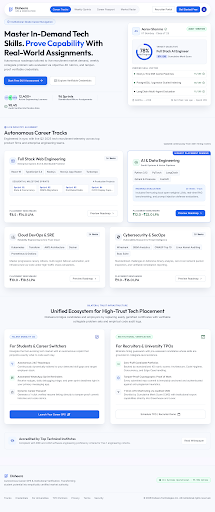
<!-- slide -->
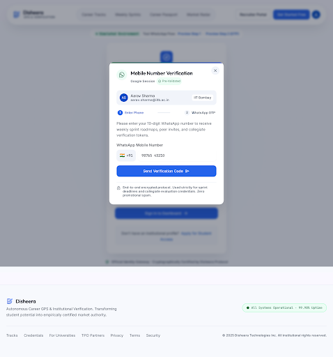
<!-- slide -->
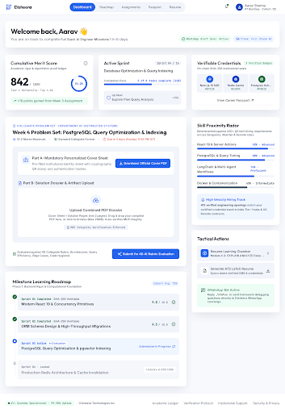
<!-- slide -->
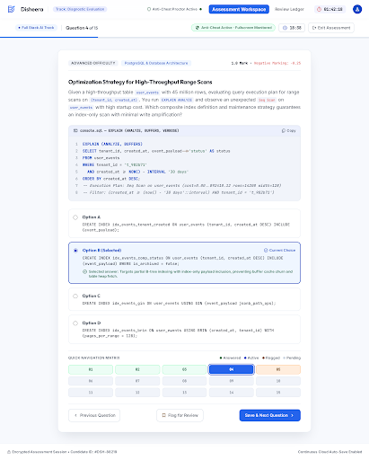
<!-- slide -->
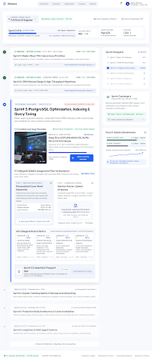
<!-- slide -->
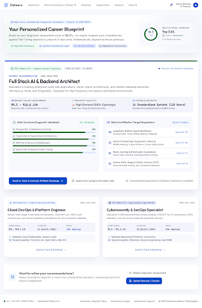
<!-- slide -->
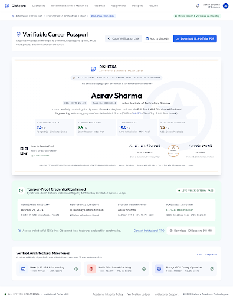
<!-- slide -->
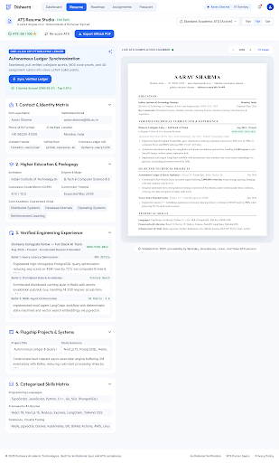
<!-- slide -->
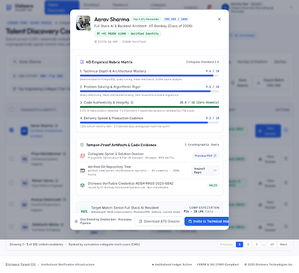
<!-- slide -->
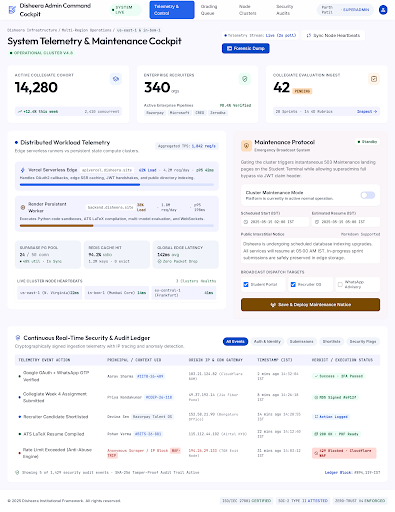
<!-- slide -->
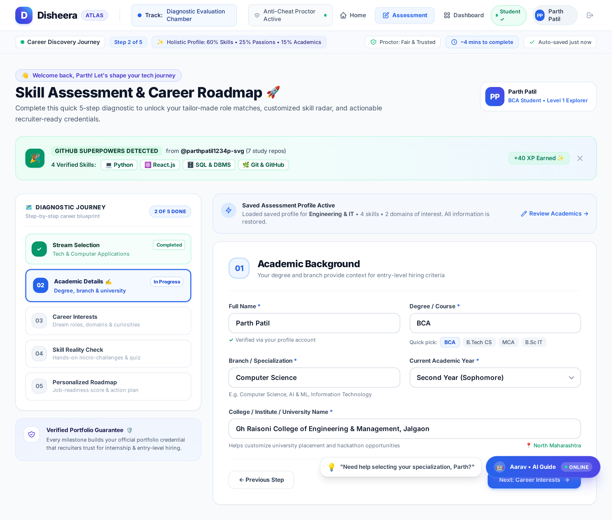
<!-- slide -->
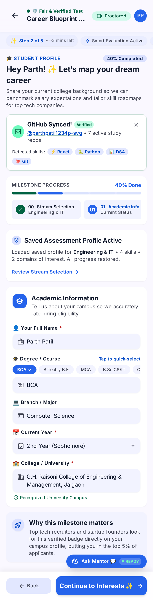
````

---

## Architectural Analysis & Integration Notes

1. **Light-Theme Token Fidelity**:
   All 10 generated pages strictly use Disheera's approved color tokens:
   - `canvas-white`: `#F7F9FD`
   - `surface-pure`: `#FFFFFF`
   - `primary-container`: `#2563EB` (Royal Blue)
   - `border-whisper`: `#E2E8F0`
   - `slate-body`: `#334155`
   - `slate-caption`: `#475569`
   - `emerald-soft`: `#ECFDF5`

2. **Tailwind Pre-configured Headers**:
   Every code file includes a self-contained `<script id="tailwind-config">` block with Google Fonts (`Outfit`, `Inter`, `JetBrains Mono`) and Material Symbols, allowing each file to be opened directly in any browser with zero build setup.

3. **Production Placement**:
   The code is readily accessible in [`stitch_screens/code/`](code) for modular integration into Disheera's client templates.
